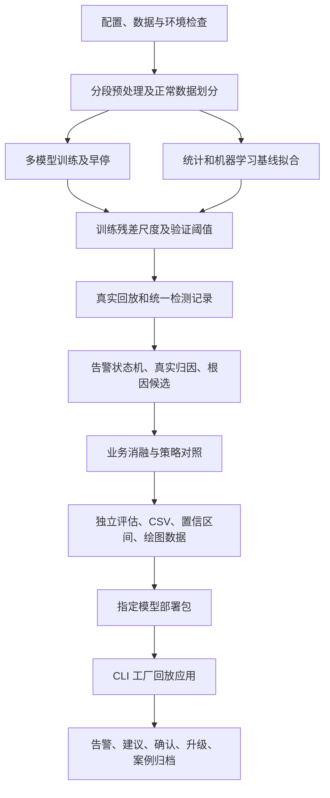

# 工业异常感知与安全决策项目续作计划及详细设计

> 编制日期：2026-11-16。  
> 实施工程：`project/`。总体设计依据：仓库根目录 `thesis_system_plan.md`；当前 `project/thesis_system_plan.md` 与其内容一致。执行记录的实际目录是 `project/log/`，不是 `project/logs/`。  
> **本文是待实施的设计，不是实施完成报告。本次仅新增此 Markdown 文件，不修改代码、配置、模型和历史实验产物，不运行训练或实验。**  
> 后文目录、配置、命令、CSV 表头和接口如标注“拟新增”或“目标”，均描述后续实现，不能当作当前已支持的功能。

## 1. 续作方向与完成标准

继续沿用原论文的“异常检测 → 根因候选 → 受约束建议 → 回放验证”方向。主要工作是把目前的工程骨架变成可信、可复现、可演示的系统，暂不增加新的神经网络结构。

最终交付应同时满足：

1. 在 macOS MPS、Linux CUDA、Windows CUDA 上使用同一套 Python 业务实现；`run_pipeline.sh` 与拟新增的 `run_pipeline.bat` 是等价入口。
2. 一个入口可以执行真实训练、早停、基线、根因方法对照、策略对照、业务消融、统计汇总、绘图数据导出和应用模型打包。
3. 某个模型触发早停后，恢复它的最佳权重，继续推理和后续实验，再处理其他模型。真实错误与早停分开处理。
4. 对比和消融的汇总、逐事件记录、训练曲线和绘图输入均保存为 CSV；体积较大的逐秒/逐变量明细同时支持 Parquet，嵌套审计记录使用 JSONL。
5. 一个可移植的工厂监控应用读取本流水线生成的模型包，使用 HAI 测试数据模拟在线监控，展示异常、候选原因、处置建议、操作员处理和案例归档。
6. 给出普通使用者能看懂的全英文工厂接入说明。本文附录 A 提供首版完整文档，实施时再以实际 CLI 核对并落到 `project/docs/FACTORY_ONBOARDING_EN.md`。

**建议的论文贡献表述**：在冻结的异常检测模型之上，构建可追溯的检测证据、过程关系、处置约束及拒绝机制，量化它们对告警负担、目标定位和处置流程的作用。模型对比是感知层的必要验证；业务消融用于回答系统模块是否产生实际价值。

### 1.1 idea-spark 的使用边界

已阅读用户指定的 [idea-spark 技能](/Users/Liang/Skills/ResearchStudio/ResearchStudio-Idea/skills/idea_spark/SKILL.md) 及其 `references/host-runbook.md`。该 runbook 将 “Engineering integration tasks” 列为不应启动完整研究想法生成流程的任务。本次是既有工程的续作设计，因此采用其“明确瓶颈、具体机制、朴素对照、可证伪预测、失败后降级”的设计原则，不启动多阶段 idea 生成、模型审稿或新颖性认证，不额外生成 idea cards。

本文没有证明方法新颖或有效；后续实验若不支持假设，应据实保留负结果。已有测试标签和历史结果已被开发者查看，后续应称“锁定协议后的重新评估”，不能宣称 HAI 测试集从未被查看。

## 2. 当前工程核查：哪些可以保留，哪些需要先修

核查依据为 `project/log/week01.md` 至 `week12.md`、`next_steps.md`、`cli_instructions.md`、当前源码及现有产物。日志的“完成”主要表示模块已写出，不等同于真实模型实验已完成。

| 现状/证据 | 影响 | 后续处理 |
|---|---|---|
| 数据处理、模型封装、检测、归因、策略、代理模型、指标和绘图模块都已存在 | 可以在现有目录内续作，无须重建项目 | 保留模块职责，统一接口和产物管理 |
| `artifacts/scores_*_MOCK.parquet` 与报告仍标注 MOCK | 现有检测/定位结果是集成输出，不能作为论文性能 | mock 与正式运行分目录；正式汇总禁止读入 mock |
| `checkpoints/TranAD_C_G_E_HAI-23.05/` 已有 best/latest；训练 CSV 仅见 epoch=0 的一行，配置记录 MPS | 日志的“尚未训练”已不完全反映磁盘现状，但不足以证明完整训练完成 | 核验 checkpoint 元数据、特征顺序、scaler、完整性和前向输出；不能只凭文件存在跳过训练 |
| 历史训练日志出现缺少 pyarrow、错误 Python 环境和旧绝对路径 `/home/devin/...` | 换机器首先可能失败于环境与路径 | 项目独立依赖、preflight、相对路径索引和显式解释器 |
| `train.py` 已保存最佳验证损失，但没有 patience/min_delta；resume 使用 `start_epoch + epochs` | 不会早停；恢复后可能额外再训练一整段 epochs | 实现总 epoch 上限和完整早停状态恢复 |
| 训练日志存在 `[1,B,D]` 对 `[B,D]` 的广播警告 | 当前数值可能依赖隐式广播，接口不够明确 | 显式统一重建和目标形状，并验证 B>1，禁止意外广播 |
| `predict_batch` 约定返回 `[B,D]`；模型内部返回 `[1,B,D]` | 接口改变容易导致静默错误 | 在 adapter 处做形状断言；训练、推理和归因使用一致约定 |
| FeatureGate 的 continuous mask 是非持久 buffer；重建模型加载权重时没有恢复该 mask | 训练与推理可能对离散通道采用不同门控 | checkpoint/bundle 显式保存并恢复特征类型 mask，检查顺序 |
| `run_detection.py` 有 robust-z、PCA、IF 实现，但只在 `--baselines` 时执行；总入口未传该参数 | 一键运行实际上不会自动完成这些基线 | 用实验注册表显式调度，不依赖目录扫描和可选参数碰巧生效 |
| `run_detection.py` 缺验证分数时会退回 test quantile | 正式实验阈值协议不合格 | 正式模式直接失败，不允许测试集替代校准集 |
| `rootcause.py` 未传 attribution 时把残差作为归因；主流水线没有真实归因生成阶段 | “full”和“attribution only”可能重复残差证据 | 显式生成真实归因，记录 evidence_method；正式 full 禁止残差冒充归因 |
| onset 当前在事件自身残差上求分位数；stability 默认是常数 | 与“验证集校准的起始证据”和“稳定性”设计不一致 | 使用固定逐通道正常阈值；实现真实历史窗口稳定性或明确禁用 |
| 检测事件、指标、代理训练存在跨文件拼接；策略以局部 `end_row` 索引合并后的 X | 文件边界可能被当成连续过程；第二个测试文件可能读错状态 | 统一 `source_file + segment_id + row_in_source` 键，分段运算 |
| 代理训练先稀疏抽行再配相邻行，验证也对抽样后的相邻行求残差 | 实际学习/校验的时间间隔可能并非 1 秒 | 先构造合法连续转移，再抽转移对；训练、验证和 rollout 时间步一致 |
| 决策和回放施加动作的方式/方向不一致；fixed hold 在代理内可能等于 no_action | “策略改善”可能来自实现差异，两个基线可能没有区别 | 共用动作转换与 rollout；检查有效控制输入是否真的不同 |
| `usable_for_policy_eval` 已写入 surrogate card，但消费端未形成强制禁用门 | 代理不合格时仍可能输出貌似有效的收益 | 预测质量、输入支持域和不确定性均进入资格门控 |
| 动作目录混有非 SCADA 点、弱证据及通用 setpoint 调整；requires 缺值时可能放行 | 无法直接作为可移植工厂动作规格 | 区分观察点、控制点、关联点，缺必需值默认拒绝，未知物理语义只允许检查类建议 |
| `vus_pr` 是简化实现；FAR 校准用超阈值点数近似告警次数 | 指标名称可能比实际定义更强；点误报率与事件误报率混淆 | 接入可核验实现；分别报告点超阈率与事件 FAR |
| 输出常用单个 `thresholds.json`、`residual_scale.json`、`rootcause.jsonl` | 模型/seed/变体运行会相互覆盖 | 每个任务独立目录，依赖通过 manifest 传递 |
| `model_state_hash` 只哈希名称和形状；`project/` 当前整体未被 Git 跟踪 | 同架构不同权重得到相同版本；父仓库 commit 无法代表此工程内容 | 增加权重文件 SHA256、源码内容哈希、配置哈希和 dirty/untracked 状态 |
| `demo_streaming.py` 已有演示草稿，但 build_model 少 dtype、索引字段不一致、阈值可硬编码回退、策略只选第一合法项 | 不能当作已经验证的业务应用 | 保留展示思路，改为调用统一 runtime 和真实策略，禁止硬编码结果 |
| `make_figures.py` 默认挑首个 score 文件，缺值延迟填 0；旧报告与当前配置分位数不一致 | 图表可能串模型、误画漏检、沿用旧结果 | 显式 run 选择、导出 plot_data、缺值按缺失处理，报告自动生成 |

这里的发现来自静态阅读和文件检查，本次没有运行模型验证；需要动态确认的行为列入 P0 验收。

## 3. 研究假设和失败判据

本轮只围绕一个系统命题：**相同感知结果下，经过过程关系、处置条件和不确定性约束的业务链，能否以可接受延迟减少无效告警与不合适建议，并保留有效的定位覆盖。**

| 假设 | 必须设置的对照 | 主要观察 | 不成立时怎么写论文/系统 |
|---|---|---|---|
| H1：改进模型在统一协议下有检测收益 | 统计基线、PCA、IF、OCSVM、普通 TranAD | eTaPR、无 PA 的点/事件指标、延迟、事件 FAR、代价 | 不把模型优势作为贡献；仍可作为固定感知器 |
| H2：业务证据链优于只给最高残差变量 | residual、真实 gradient、occlusion、完整融合；图负控 | 严格可观测目标命中、弱关联目标命中、MRR、拒绝与覆盖 | 完整融合不优则保留更简单方法；撤回拓扑有用的结论 |
| H3：告警整理和安全门控改善处置流程 | 逐点告警、无过程信息、无 RCA、无不确定性门控 | 告警负担、重复建议、正常段调整建议率、覆盖/拒绝、响应延迟 | 不用更高拒绝率掩盖覆盖下降；保留负结果 |
| H4：模型辅助策略在合格代理环境有额外收益 | 告警无动作、固定有效规则、RCA 规则、完整策略 | surrogate-only 风险、动作成本、支持域覆盖、跨代理一致性 | 代理或动作响应不合格时停止效果主张，交付监控与处置流程 |

**负控与业务消融分开保存**：随机图、目标置换属于可信度检查；PA 与非 PA 是评价协议检查；C/G/E 神经网络模块开关不纳入本轮消融。

## 4. 目标结构和模块契约

### 4.1 两条共用核心的执行路径



训练/实验负责生成模型与评估结果；应用负责读取已经冻结的模型包。应用不重新训练、不重新拟合阈值，不从历史指标 CSV 伪造在线输出。`src/runtime/` 是两者共同调用的业务实现，评估标签只进入 `src/bench/`。

### 4.2 拟新增/调整目录

```text
project/
  config/
    experiment.yaml
    suites/{full,smoke,business_ablation}.yaml
    sites/{hai2305,factory_example}.yaml
    ablations/business.yaml
    plots.yaml
  src/
    common/{device,config,provenance,schemas,io_utils}.py
    data/{prepare_hai,prepare_factory,window,segments,split_protocol}.py
    models/{train,early_stopping,load_checkpoint,registry}.py
    baselines/{statistical,pca,isolation_forest,ocsvm}.py
    detect/{score,calibrate,replay,alarm_state}.py
    explain/{attribution,run_attribution,rootcause}.py
    decision/{action_catalog,shadow_policy,action_transform}.py
    sim/{fit_surrogate,validate_surrogate,rollout,closed_loop}.py
    bench/{run_detection,run_rca,run_policy,ablation,metrics,bootstrap}.py
    runtime/{bundle,engine,contracts,replay_source,case_store}.py
    app/{cli,display,commands}.py
  scripts/
    reproduce_all.py
    run_pipeline.sh / run_pipeline.bat
    run_train.sh / run_train.bat
    run_app.sh / run_app.bat
    preflight.py / export_bundle.py
    make_figures.py / package_artifacts.py
  requirements/{base,dev,app}.txt
  environment/{macos-mps,linux-cuda,windows-cuda}.md
  docs/{EXPERIMENTS,CSV_DICTIONARY,APP_GUIDE,FACTORY_ONBOARDING_EN}.md
  tests/
  runs/<run_id>/
    run_manifest.json / resolved_config.yaml / task_registry.csv
    shared/<data_fingerprint>/
    models/<model_id>/seed_<seed>/
    experiments/<experiment_id>/seed_<seed>/
    tables/ / plot_data/ / figures/ / reports/
  bundles/<bundle_id>/
  app_runs/<session_id>/
```

旧 artifacts 作为历史记录保留；新运行只读本次 manifest 列出的依赖。数据缓存可共享，模型相关尺度、阈值、归因与策略输出不共享路径。上述目录是职责设计，实施可合并小文件，但不能让应用和实验各自维护一份算法。

### 4.3 核心数据对象

| 对象 | 关键字段 | 生产者 → 消费者 |
|---|---|---|
| TelemetryFrame | site_id、source_file、segment_id、row_in_source、timestamp、ordered_values、quality_flags | reader → runtime |
| DetectionRecord | sample_id、score、threshold_id、channel_evidence、warmup、model_id、权重哈希 | scorer → alarm/RCA/evaluator |
| AlarmUpdate | alarm_id、state、first_trigger_at、last_positive_at、reason、decision_time | 状态机 → RCA/policy/application |
| RootCauseRecord | alarm_id、as_of_time、完整变量排名、证据分解、support_type、confidence_kind、abstain_reason | RCA → policy/evaluator |
| ActionAdvice | advice_id、有效期、rootcause_version、候选动作、选中动作或 null、逐项约束、mode、rationale | policy → case workflow |
| CaseUpdate | case_id、关联告警/建议、操作人或系统角色、动作、时间、原因、前后状态 | app → SQLite/JSONL/CSV |

事件 ID 不从测试标签生成。模型、排序与决策函数不接收 attack_id、label_attack、target_points。评估器通过 sample_id/时间区间单独关联真值。

## 5. 数据协议和可移植输入

### 5.1 固定原始数据分工

- 正常训练：HAI `hai-train1..3.csv`，目前合计 698,400 行。
- 原正常验证文件：`hai-train4.csv`，目前 198,000 行。
- 最终评估：`hai-test1..2.csv`，目前合计 284,400 行；52 个标签事件的实际可用目标数量由审计重新统计。
- label-test2 的行位置对齐属于 HAI 23.05 专用适配：要求原始文件哈希、行数、分钟时间差及 summary 检查通过。不能把这个例外推广到其他工厂。
- 官方 HAI 推荐 eTaPR 作为比较指标，因此将其保留为正式结果之一。[HAI 官方说明](https://github.com/icsdataset/hai)

### 5.2 正常验证数据进一步分工

把 train4 按时间顺序划为三个明确区段，边界记录到 `split_manifest.json`：

| 区段 | 建议起始比例 | 用途 |
|---|---:|---|
| val_model | 前 40% | 早停、模型选择、正常预测误差检查 |
| val_uncertainty | 中 20% | 代理误差区间/不确定性校准 |
| val_threshold | 后 40% | 检测总体阈值、逐通道 onset 阈值、正常段事件 FAR |

这是本轮新协议，旧结果不能直接横比。边界处保留至少 W−1 行隔离区，并分别构造窗口；写清实际保留/排除行数。若数据质量检查使某区间过短，在首次 test 评估前调整并冻结协议。不得用 test 指标决定划分。

输入 scaler、残差尺度、baseline 拟合仅用 train normal；模型残差尺度来自**对应最佳 checkpoint 的训练重建残差**。阈值只用 val_threshold。验证区段本身的用途也要写入每个产物的 provenance。

### 5.3 行、时间和窗口规则

1. 统一主键：`sample_id = hash(dataset_id, source_file, segment_id, row_in_source)`。绝不只凭拼接数组的位置关联状态。
2. 文件切换、时间缺口、重复/倒序时间、设备重启标记均切段；窗口、事件合并、EWMA、代理转移和 bootstrap 分组不得跨段。
3. 索引只保存相对于数据根目录的路径；运行时通过 Path 解析。读取旧绝对路径时提示重新 prepare 或执行显式迁移，不能悄悄修改原始文件。
4. timestamp 解析失败必须报出文件和行，正式模式不接受 NaT。没有来源时不能直接给 HAI 原始本地时间加 UTC 的 Z。
5. 主实验保留 W=128、评分 stride=1；使用历史 127 秒上下文。段首 replicate 行可参与输入但标记 warmup，主指标排除 warmup，另报覆盖损失。应用预热和实验规则一致。
6. 内存中保留原始物理值与模型缩放值。模型裁剪值只用于推理，不能用于掩盖真实越界；质量检查、动作约束和界面显示使用原始物理值。
7. 所有模型按相同的有效时间点评分。瞬时统计/ML 基线也在公共有效区间报告，另可导出完整时段附表。
8. 缺失关键变量禁止用 0 补齐继续出动作建议；短缺失是否前向填充必须由站点配置明确限制，并保留标志。离散变量不做线性插值。

## 6. 训练早停的完整设计

### 6.1 配置和指标

训练“性能不再提升”默认指 **val_model 上的重建 MSE 不再改善**，不指测试集 F1。正常验证集没有攻击标签，不可在每个 epoch 用 HAI test 的 F1 挑模型。

拟增加的初始配置：

```yaml
training:
  max_epochs: 50
  batch_size: 128
  seed: 1
  train_stride: 1
  early_stopping:
    enabled: true
    monitor: val_recon_mse
    mode: min
    min_epochs: 5
    patience: 5
    min_delta_abs: 0.00001
    min_delta_rel: 0.001
    restore_best: true
    check_every_epochs: 1
```

这些数值是待做正常数据 smoke 验证的起始值，不是已经调优的参数。模型对照使用同一上限和早停规则；每个模型有独立状态，不能共享 patience 计数。

### 6.2 精确行为

- 统一输出与目标形状 `[B,D]`，逐元素求 MSE，再按样本加权聚合；train loss 可以包含既有辅助项，monitor 不包含随 epoch 改变权重的辅助损失。
- 维护 `best_metric`、`best_epoch`、`patience_reference`、`bad_epochs`。每次严格降低 best_metric 都保存 best；只有相对 patience_reference 的降低超过 `min_delta_abs + min_delta_rel × abs(patience_reference)` 才重置 bad_epochs 并更新 reference。
- 第一次得到有限验证指标建立 reference；其后未达到有效改善的验证轮数累计。达到 min_epochs 且 bad_epochs ≥ patience 时结束训练。
- 训练器写 `stop_reason=early_stopping`，返回退出码 0。主流水线读取 summary，继续本模型残差拟合/推理，也继续其他模型的任务。
- 到达 max_epochs 写 `stop_reason=max_epochs`，同样返回 0。两者均要求有效 best checkpoint。
- NaN/Inf、空训练/验证集、权重损坏、加载不兼容属于失败。不得将这些错误写成早停成功。
- 早停后明确加载 best 权重，再导出推理权重；latest 用于恢复，不是最终评分模型。

### 6.3 恢复训练和检查点

`latest.ckpt` 保存：模型参数、optimizer、scheduler、epoch、best 指标/epoch、patience reference、bad_epochs、随机数状态、采样器状态、全部已完成历史、特征顺序与 mask、配置/数据指纹、完整模型构造参数。

`max_epochs` 是从第一次训练开始的**总上限**。例如已完成 12 轮、上限 50，恢复后最多剩 38 轮；不能再训练 50 轮。已 early-stop 的任务默认视为已完成，只有新 run 或显式重训才重启。

检查点使用临时文件写完后原子替换；恢复前校验数据、模型结构、mask、W、seed 和配置。更改核心参数需要新任务，不在原目录覆盖。训练历史追加并去重，不因 resume 覆盖前半段。

### 6.4 必须导出的训练记录

`training_history.csv`：run_id、model_id、seed、epoch（统一从 1 开始）、train_loss、train_recon_loss、val_recon_mse、learning_rate、improved_best、improved_reference、bad_epochs、epoch_seconds、train_windows、val_windows、device。

`training_summary.csv`：planned_epochs、completed_epochs、best_epoch、best_metric、stop_reason、best_checkpoint、checkpoint_sha256、total_train_seconds、resume_count、data_fingerprint、config_hash。

验收用确定性损失序列检查状态机：patience=3、min_epochs=3 时，验证值 `0.50, 0.40, 0.39, 0.391, 0.392, 0.393` 应在第 6 轮结束，best 为第 3 轮，退出码为 0，随后运行的校准/推理测试阶段必须被实际调用。此测试不需要训练神经网络。

## 7. 一键流水线、断点续跑与 Windows 入口

### 7.1 Python 是唯一编排器

扩展现有 `scripts/reproduce_all.py`，把 shell/bat 缩为参数转发器。Python 负责参数校验、任务图、目录、日志、超时/中断记录、失败聚合和打包；不用 bash 循环实现一份实验逻辑，再用 bat 重写另一份。

建议目标参数：

| 参数 | 设计语义 |
|---|---|
| `--config` / `--site` | 实验协议与站点输入配置 |
| `--suite smoke\|full\|business_ablation\|onboarding` | smoke 为独立功能检查；full 包含全部必需实验；onboarding 为新工厂训练打包 |
| `--device auto\|mps\|cuda\|cpu` | 神经网络设备，ML/统计仍在 CPU |
| `--seeds 1,7,21` | 完整实验初始设三种 seed；冻结后记录 |
| `--max-epochs` / `--patience` / `--min-delta-abs` | 覆盖训练控制项并写 resolved_config |
| `--models` / `--experiments` | 明确子集；子集运行不能标记 full suite 完成 |
| `--run-id` / `--resume` | 新建隔离运行或恢复同一指纹任务 |
| `--skip-train --checkpoint-manifest <file>` | 明确每个必需模型/seed 对应的已有 checkpoint |
| `--mock` | 仅 smoke 允许；不能通过 full 的正式结果检查 |
| `--export-csv` / `--export-bundle` | 导出表格与指定部署包 |
| `--fail-fast` | 调试时首错退出；默认先完成相互独立的任务再汇总错误 |

旧 `--epochs` 可作为 max_epochs 的兼容别名，输出弃用提示；两者同时提供不同值时拒绝。旧单 checkpoint 参数仅允许单模型/单 seed 子集，不能冒充整个矩阵已具备权重。

### 7.2 阶段顺序与依赖

1. preflight：解释器/依赖/设备小张量、目录可写、数据 manifest、配置、实验注册表。
2. prepare：检查 schema/时间 → 分段 → 相对索引 → 正常区段划分 → scaler/graph。
3. fit：拟合统计/ML；训练 TranAD 和 C_G_E 的各 seed，分别处理早停。
4. calibrate：各 checkpoint 的 train residual scale → val_threshold 分数 → 总体/通道阈值及事件 FAR 审计。
5. replay：逐文件测试评分；事件状态机；按告警生成真实归因及 RCA。
6. surrogate：构造正常转移、拟合和验证资格；不合格则禁用效果型 rollout。
7. experiments：执行检测对照、RCA 对照、策略对照、业务消融和负控。
8. evaluate：公共时间键核对 → 逐事件指标 → 多 seed/配对区间 → 统一 CSV。
9. render：仅从导出的 plot_data 和 tables 生成图片/表格，自动更新本次报告。
10. export：指定的主模型部署包、完整结果清单、可移植应用运行说明。

每一步返回产物描述对象，不以猜测路径或 `glob("scores_test_*")` 选择输入。所有子进程用 `subprocess.run([sys.executable, ...], shell=False)`，使用同一个解释器。

### 7.3 状态、失败与复用

任务状态：PENDING → RUNNING → SUCCEEDED / FAILED / SKIPPED_DEPENDENCY / NOT_APPLICABLE；复用任务记录 REUSED。early_stopping 是训练成功的 stop_reason，不是 FAILED。

- 单个训练失败：保存错误，跳过依赖它的任务，继续独立 baseline 和其他模型；最后返回非零并标记 incomplete。
- 必需任务失败不能静默从总表删除。CSV 保留 status、reason、n_valid。
- 代理资格不通过：属于科学上可接受的降级；继续告警、定位、检查建议和业务流程，策略效果行记 NOT_APPLICABLE，指标为空。套件可完成，但报告不得含效果结论。
- 缓存键包含输入文件哈希、源码哈希、resolved_config、模型/seed、权重哈希和依赖版本；变更 RCA 不重训模型，但必须重算 RCA 及其下游策略。
- 中断后记录未完成任务和最近有效检查点；resume 校验所有输出哈希，不能只看 done 文件。
- 控制台与文件日志由 Python 同时输出，避免依赖 Windows 没有的 tee、date、find 或 GNU 参数。
- 禁止并发运行共享同一 run_id；进程锁、超时后的锁恢复和 PID 失效检测需覆盖 Windows。

### 7.4 shell/bat 等价设计

以下为拟实现的 bat 包装器结构，实际文件本次不创建：

```bat
@echo off
setlocal DisableDelayedExpansion
pushd "%~dp0.." || exit /b 2
if defined PYTHON (
  set "PY_EXE=%PYTHON%"
) else (
  set "PY_EXE=python"
)
"%PY_EXE%" "%~dp0reproduce_all.py" %*
set "RC=%ERRORLEVEL%"
popd
exit /b %RC%
```

`PYTHON` 约定为解释器可执行文件路径，不包含额外参数；所有路径正确加引号。shell 用脚本自身路径定位 project，并 exec 同一个 Python 入口。bat 关闭 delayed expansion，避免含 `!` 的路径被破坏；返回原始退出码。

目标命令示例（实现后才可执行）：

```bash
# macOS
bash scripts/run_pipeline.sh --config config/experiment.yaml --site config/sites/hai2305.yaml --suite full --device mps --seeds 1,7,21 --max-epochs 50 --patience 5 --export-csv --export-bundle

# Linux
bash scripts/run_pipeline.sh --config config/experiment.yaml --site config/sites/hai2305.yaml --suite full --device cuda --seeds 1,7,21 --export-csv --export-bundle
```

```bat
rem Windows CMD, after activating the intended Python environment
scripts\run_pipeline.bat --config config\experiment.yaml --site config\sites\hai2305.yaml --suite full --device cuda --seeds 1,7,21 --export-csv --export-bundle
```

## 8. 必需的检测对比实验

### 8.1 正式实验矩阵

| experiment_id | 方法 | 拟合和评分方式 | 主要定位 |
|---|---|---|---|
| D01 | Robust-Z / MAD 阈值 | train median/MAD 标准化；连续通道 max evidence；正常验证校准总体阈值 | 强朴素统计基线 |
| D02 | EWMA 统计基线 | 用过去状态预测本秒，评分后再更新均值；初始 α=0.2，按段重置 | 带时间平滑的统计方法 |
| D03 | PCA reconstruction | train 拟合 PCA，重建残差按训练残差尺度归一化 | 传统线性 ML |
| D04 | IsolationForest | train 拟合，`-score_samples` 统一为越大越异常 | 非线性传统 ML |
| D05 | One-Class SVM | 正常子集拟合 RBF OCSVM，`-decision_function`，验证阈值 | 边界式传统 ML |
| D06 | TranAD | 项目普通 TranAD，统一 scaler、W、训练协议和 Top-k=3 聚合 | 基础神经模型 |
| D07 | TranAD_C_G_E + TOPk | 现有 C/G/E 实现，Top-k=3，作为主系统感知器 | 用户指定主方法 |

主比较对 TranAD 和 C_G_E 使用相同评分聚合，减少“模型变了同时聚合也变了”的混淆。如果需要历史常见 mean 聚合，可追加 `D06_MEAN` 附表，复用同一 checkpoint，不将它作为 C/G/E 模块消融。

普通 TranAD 采用项目适配后的实现与统一协议，称为“本工程协议下的 TranAD 对照”；不声称复现原论文表格数值。实现来源与原论文应保留引用。[TranAD 官方实现](https://github.com/imperial-qore/TranAD)

### 8.2 公平性与初始参数

- 所有方法只用正常训练数据；相同特征集合、公共有效时间点和独立正常校准区段。
- D01 连续通道 MAD 为 0 时采用 train scale 下限；离散通道使用正常取值集合/频率惊异度的预定规则，不能用极小分母制造无穷异常。规则写入模型卡。
- D02 的更新不读取未来点、事件结束和攻击标签；固定系数，敏感性分析独立标记。
- PCA 初始 components=20（受特征数和样本数约束）；IF 初始 200 棵树、max_samples=256；OCSVM 初始 nu=0.01、gamma=scale。参数不是测试集搜索结果。
- PCA/IF 初始拟合上限 50,000 个正常样本，按训练文件比例抽样；OCSVM 初始 5,000。保存抽样 sample_id 和 seed，不把限额隐藏。数据预处理不因方法改变。
- 神经模型默认使用完整正常训练窗；不得为了某个平台自动截断数据。小样本仅属于 smoke/预算实验，独立表格。
- 正式随机模型使用 seeds=[1,7,21]；完全确定性的统计基线只拟合一次，不能复制三行当成三次独立重复。
- Top-k=3 在首次正式评估前固定；如分析 k∈{1,3,5,10}，列为评分敏感性，不以 test 最佳 k 替代主结果。
- OCSVM 超时应报告失败/耗时和已冻结的样本预算，不能悄悄换算法。更换预算在新 run 中进行并明确协议版本。

## 9. 业务消融：固定感知模型，只拆业务能力

业务消融统一复用 D07 各 seed 的 checkpoint、尺度、阈值和逐秒分数。对同一 seed 使用相同输入。每次只移除一项业务能力，并重新执行受影响的下游流程。

| id | 变体 | 实际改变 | 检验的业务问题 | 主要记录 |
|---|---|---|---|---|
| B00 | Full business chain | 完整告警、过程证据、RCA、门控、处置工作流 | 共同参照 | 全部指标 |
| B01 | No alarm consolidation | 每个超阈值点生成独立告警请求，取消合并/冷却/去重，阈值不变 | 告警整理能否降低操作员负担 | requests/hour、重复工单、响应时延、事件覆盖 |
| B02 | No process context | RCA 和动作路由都不使用过程图/控制回路关系；保留法定动作边界 | 过程知识是否帮助定位和具体建议 | 目标命中、泛化检查占比、建议覆盖 |
| B03 | No RCA routing | 决策只看告警等级和当前物理值，不接收候选排名；保留同一动作目录 | 定位是否能改善“该检查哪里” | 正确回路覆盖、无关建议、处置成本代理 |
| B04 | No evidence abstention | 取消低 margin/低稳定性触发的建议拒绝；保留数据质量、物理和目录硬约束 | 证据不足时拒绝是否减少不当建议 | coverage–risk、正常段建议率、拒绝原因 |
| B05 | No uncertainty gate | 在离线影子实验中绕过代理不确定性/支持域门；仍保留静态合法性约束 | 不确定性门控的覆盖与风险代价 | OOD 请求率、预测越限、拒绝、代理分歧 |
| B06 | No context-aware action choice | 不用 RCA/风险排序，选预定的适用保守规则；共用相同合法性校验 | 自适应动作选择是否优于简单规则 | 动作 mix、成本、surrogate-only 风险 |
| B07 | No response deduplication | 同一事件每次更新都重新提出建议，取消 advice_id 幂等与冷却 | 处置节流能否避免重复操作 | 建议数、重复率、操作员处理次数 |

约束：

1. B01 与 B07 分别拆告警对象层和建议层，不能混成同一消融。
2. B02 的“无过程上下文”与 RCA 对照中的“仅无图排序”范围不同；产物显式标注受影响模块。
3. B04/B05 只在离线实验打开，不成为默认应用运行配置。缺关键输入、动作越权、非法值等硬边界不因消融取消。
4. 去掉一项融合证据后，将其余正权重重新归一化；不保留无意义的常数 evidence。
5. 必须保存实际开关、resolved_config、上游指纹及逐事件输出。仅删 CSV 某列或在旧结果上改名字不算消融。
6. 对 B00 与各变体做同事件配对差值；不要求每个移除实验都下降，更不能删去负结果。

### 9.1 可信度检查单独列组

`N01`：过程图保持节点集合和近似度分布的重连，多个固定 seed；避免制造大量自环/重复边。  
`N02`：在同一可评估目标池内置换严格目标，保留目标个数和可观测性分层。  
`N03`：打乱 onset 证据的变量归属，不修改标签或线上决策时间。  
`N04`：原始指标与 PA-F1 并列，PA 仅附录。  
`N05`：输入中的标签列/文件名/target 文件访问审计，确认它们不影响模型和策略输出。

负控没有下降只能提示需排查证据作用或标签范围；不能单靠一次目标置换结果证明“完全无泄漏”。

## 10. 根因候选方法对照与真实证据实现

### 10.1 对照方法

| id | 方法 | 输入证据 |
|---|---|---|
| R01 | Residual only | 标准化逐通道残差 |
| R02 | Input gradient only | 对真实 checkpoint 的异常分数求输入梯度 |
| R03 | Occlusion only | 用训练正常中位数替换单通道历史，测分数下降 |
| R04 | Fusion without graph | 残差、真实归因、已校准 onset、历史稳定性 |
| R05 | Full fusion | R04 + 有来源的过程图支持 |

attention only 只有在实现了可解释的**变量级**映射并记录其定义后才作为可选附表。现有 TranAD 注意力主要含时间维，不能直接把时间注意力均值当作传感器根因排名。

### 10.2 证据计算细节

- `run_attribution.py` 为真实推理增加正式产物：`sample_id, as_of_time, tag, attribution_value, attribution_method, checkpoint_sha256`。
- gradient 使用与检测一致的残差尺度和 Top-k 目标；输入/窗口形状相同。梯度计算要启用 autograd，不能包在 inference_mode 内。推理后释放计算图。
- occlusion 用 train normal 的缩放空间中位数，离散变量使用正常合法模式；不把全部变量置零。各方法记录调用数、耗时、参与变量。
- 主方案在告警首次触发和每 5 个数据秒更新一次解释，只能使用截至当时的窗口。额外频率敏感性独立记录。
- RCA 不等到整段攻击结束才给出首个结果；最终事件摘要可以追加，但不能回填成最初决策。
- onset 用 val_threshold 拟合的各通道证据分位数；候选首次超阈时间从截至当前的证据历史寻找，未出现记 unavailable。
- stability 初始定义为最近 L=5 次实际 RCA 更新中，该变量进入 Top-3 的频率；不足 L 时记录实际次数，作为历史稳定度而非置信概率。去除固定 0.5 占位值。
- 保留现有初始权重 0.30/0.25/0.15/0.20/0.10，但输入证据归一化规则固定并导出；不得用测试目标重估权重。
- confidence 初期称 `evidence_score/margin`，不是“80% 根因概率”。若需概率校准，必须引入独立有标签开发数据，另设协议。
- 不以“只算前 200 个告警”静默省算力。有限预算时采用预先固定的周期/抽样并报告 coverage；没有算到的事件记缺失/拒绝，仍进入端到端分母。

### 10.3 真值和统计单位

必须区分两个目标集：

1. `strict_observable_target`：官方直接操作点与实际输入特征交集。仅此集合支持“可观测攻击目标命中”表述。
2. `associated_loop_tags`：现有 `observable_tags` 中由过程关系映射的受影响/关联变量，属于弱定位参考。命中它们不等于找到了真实物理根因。

内部 PLC 点不在 SCADA 输入时，严格定位记不可评估，另报数量及覆盖，不能借关联变量将严格命中变为成功。每条映射保存来源、映射类型和可信等级。

评估按**真实攻击事件**汇总，一次攻击被切成多个预测告警时不能重复增加权重。同一方法至少输出：

- 检测到的公共事件集上：条件 Top-1/3/5、MRR。
- 全部有严格可观测目标事件上：端到端 Top-k/MRR；漏检或决策截止前无排名记 0。
- `t_alarm`、`t_alarm+5s`、`t_alarm+10s` 的排名快照和首次命中延迟；未来信息不得参与早期快照。
- 拒绝率、解释覆盖、无目标可评估数量、图覆盖/无图覆盖分层。

完整排名保存 86 个变量；界面只显示 Top-3，不能因为 JSON 只保留 Top-10 而让 MRR 定义改变。

## 11. 下游安全决策对照及代理评估修正

### 11.1 必需策略

| id | 策略 | 输出行为 |
|---|---|---|
| P00 | Alert only / no action | 记录告警和人工升级，不提出物理调整 |
| P01 | Fixed conservative rules | 按预登记的过程规则和当前物理值选适用保守建议 |
| P02 | RCA-guided rules | 根据候选回路选择检查/保守建议，不用代理优化 |
| P03 | Full constrained shadow policy | RCA + 有效动作目录 + 支持域/不确定性门 + 有资格时的风险排序 |

P01 不能永远选择“目录第一条”。若有效动作与 no_action 在代理中完全相同，必须显示等价，不能将其包装成独立控制效果对照。检查类动作可以有不同处置成本，但不赋予虚构的物理状态改善。

### 11.2 动作目录的数据结构

每个动作至少保存：

`action_id, kind, description_en, equipment_id, applies_to, required_tags, control_tag, unit, direction_rule, max_delta, absolute_bounds, rate_limit, cooldown_s, requires, approval_level, rollback, evidence_source, review_status`。

- `observed_tag`、`control_tag`、`affected_tag` 分开。不能把希望下降的压力/温度测量值直接修改后送入代理，作为控制动作效果。
- 动作条件使用原始物理单位；单个动作明确作用于哪一个控制点，不因一个回路异常同时调整所有 setpoint。
- requires 的变量缺失、单位不明、review_status 未通过时，不允许物理调整建议；仍可输出检查/升级。
- `hold` 指保持当前合法控制输入；`no_action` 指遵循已声明的输入延续规则。两者若无区别，在表中合并或解释等价。
- inspect/ticket/escalate 是工作流动作，不改变过程状态。人工确认产生新的 CaseUpdate，不修改历史原始 telemetry。
- 选动作和回放共用 `action_transform.py` 与 `rollout.py`。方向、单位换算、delta 和频率完全一致。

### 11.3 动作条件代理模型

先修正现有模型的时间和索引问题，再评估是否足够支持策略对照：

1. 按同文件/连续段构造 `(state_t, control_t) → state_(t+1)`。先生成合法 1 秒转移对，再按预算抽样；禁止先稀疏抽原始行再假设它们相隔 1 秒。
2. state 包括观测物理状态，control 仅包括真实可获得的命令/设定值；离散运行模式保留类型。缺少合法控制输入时，只训练预测模型，不宣称可估计动作效应。
3. 初始可用 Ridge：`s_(t+1)=A s_t+B u_t+b`，与 persistence、无动作条件的 AR/Ridge 做预测误差对比。动作只改变 u，不直接编辑结果变量。
4. train 拟合；val_model 检查预测；val_uncertainty 校准逐变量和 H 步误差区间；val_threshold 不反过来用于动作模型选型。
5. 校验 1 步和 H=5 步误差、区间覆盖与宽度、每个关键物理点的误差，不能只看全部 86 点的中位数。
6. 每条请求检查当前状态、控制值、变化率及候选动作是否位于训练支持域。预测 clipping 不是安全约束，越界需在 clipping 之前记录。
7. surrogate card 增加 `prediction_usable`、`action_response_qualified`、`support_domain`、`horizon_seconds` 和拒绝原因；消费端强制执行。
8. 资格阈值先在正常数据上冻结。若未优于 persistence、关键点区间不可靠、候选动作缺支持或控制输入无法识别，则效果评估记 NOT_APPLICABLE。

**即使动作条件预测通过，HAI 正常历史仍是观测数据；控制器反馈和未观测因素可能混淆动作响应。预测合格不等于干预因果识别。** 所有风险收益仍称 surrogate-only，不称真实工厂风险下降。

如要提出更强效果结论，追加独立 HIL/数字孪生验证是后续研究条件；不把它设为本轮交付应用的阻塞条件。

### 11.4 策略选择和评估分离

固定时间 t 的目标：

\[
J(a)=\lambda_r\sum_{h=1}^{H}Risk(\hat{s}_{t+h})
     +\lambda_m\lVert \Delta u(a)\rVert^2
     +\lambda_c Cost(a)
\]

合法动作集先经过输入质量、物理边界、变化率、支持域和资格检查，之后才排序。无正收益、证据不足或预测不可靠时输出 abstain + 可执行的人工检查/升级流程。`lambda_move` 必须实际参与计算，不只存在配置里。

对比使用同一 t、x、u 历史、horizon 和外生输入延续规则，不用未来真实控制输入帮助某个策略。建议和评估的 action_id、delta、rollout traces 可逐行比对。

同一代理既选动作又评分可能偏乐观。至少增加独立拟合/不同模型设定的评估代理或跨参数敏感性，保存 `planner_model_id`、`evaluator_model_id` 和排名一致性；独立代理不通过预测资格时，该敏感性也标记不可用。即使通过，仍不升级为真实干预证据。

### 11.5 决策指标的解释边界

- 合法率分母为真正选中的建议，不把 abstain 自动算作合法建议；另报尝试数、被拒数、拒绝原因和总覆盖。
- 正常段调整建议次数/小时、重复建议、无来源动作请求、输入缺失时拒绝等可直接审计。
- “正确回路建议率”依赖独立登记的目标/回路映射，属于弱标签一致性指标；不是“修复成功率”。
- 若建立专家处置参考，需先冻结规则并由不同于策略作者的人员核对；没有独立参考时只称 rule-consistency。
- 所有策略同时报告处理覆盖、拒绝、missed attacks、延迟和动作成本。始终拒绝不算最优业务策略。
- 动作安全约束由代码强制满足时，合法率 100% 主要验证实现，不能单独支撑方法优越性。

## 12. 检测指标、事件匹配和统计协议

### 12.1 主指标与补充指标

| 任务 | 主指标 | 必须并列的代价/覆盖 |
|---|---|---|
| 检测 | eTaPR、point AP、未做 PA 的 point precision/recall/F1、事件 precision/recall/F1 | 事件 FAR/hour、检测延迟、有效评分时长、漏检数 |
| 定位 | strict-target Top-1/3/5、MRR、端到端命中 | 可评估目标覆盖、解释覆盖、拒绝、延迟 |
| 业务告警 | 每小时告警请求、重复告警/建议、每攻击对应工单数 | 事件检出、首响延迟、正常运行时间 |
| 决策 | 合法建议率、正常段调整建议率、覆盖/拒绝、成本 | 各拒绝原因、遗漏事件、有效建议时延 |
| 合格代理策略 | surrogate-only risk、越限比例、相对 P00/P01 的配对收益 | 支持域覆盖、区间宽度、planner/evaluator 分歧 |
| 效率 | 单窗 batch=1 推理 p50/p95、解释 p50/p95、端到端 p95 | 吞吐、物理 batch、内存、训练时间/轮数 |

point AP 使用标准 average precision，另有梯形 PR-AUC 时用不同名字并保存实现。当前通过重排 recall 求面积的实现需核对。ROC-AUC 为补充，标签单一时记 undefined，不填 0。

VUS-PR 接入作者维护实现并锁定版本、buffer 范围及采样策略，不能把当前简化函数继续当成标准 VUS。若依赖未就绪，正式表记录 unavailable；不得使用近似值顶替。[VUS 作者实现](https://github.com/TheDatumOrg/VUS)

eTaPR 需验证参数接口和结果字段，用固定小样例与官方实现对齐。初始沿用现有 theta_p=0.7、theta_r=0.1、delta=0 的协议，但明确这是项目预先固定值，不冒充 HAI 全版本唯一官方参数。[eTaPR 作者实现](https://github.com/wshw4ng/eTaPR)

### 12.2 阈值与事件 FAR

- 默认保持 quantile=0.999，并逐方法独立校准；这不意味着各方法具有完全相同的事件 FAR。
- 可追加 matched-FAR 对照：只在正常 val_threshold 上，运行同一告警状态机，搜索达到预定 FAR 目标的阈值；搜索规则预先固定，目标初值 0.5 个事件/小时。
- 点超阈比例记 `point_exceedance_rate`；每小时超阈点数记 `exceeding_samples_per_hour`；合并后的假告警次数/小时记 `false_alert_events_per_hour`，三者不得混称。
- FAR 分母默认是有效正常数据时长；同时输出完整评分时长和正常/攻击时长。正常时长不足导致估计粗糙时报告可达到的分辨率。
- 阈值文件绑定 model、seed、score aggregation、scaler、residual scale、校准区段和 alarm policy。B01 固定原阈值，评估取消合并的实际代价，不为它重新调阈值抵消消融。

### 12.3 事件匹配与延迟

1. 各 source/segment 独立生成真实事件和预测事件。
2. 主要事件 precision/recall/F1 使用区间有交集的一对一匹配：先最大化匹配数，再按交并比和起点进行确定性破同分。一个持续全程的告警不能同时变成 52 个匹配成功。
3. 另报 any-overlap 的 `attack_event_coverage`，名称与一对一 event recall 区分，显示长告警覆盖和碎片化问题。
4. 重复告警、未匹配预测告警、跨攻击持续告警单独记录。预测事件超过文件边界必须切开。
5. 检测延迟从真实攻击起点到其范围内首次有效告警证据计算；攻击开始前已激活的告警单独标记 preexisting，并说明其起点不可归因于该攻击。
6. 漏检延迟为空并记录 missed=true；不填 0。报告“命中事件条件下延迟”和“在 10/30/60 秒内检出的比例”，防止只显示易检事件的低延迟。
7. 事件包含多个目标时，Top-k hit 与 target recall 分开：命中任意目标和覆盖全部目标是不同问题。

### 12.4 随机种子和区间

固定 seeds=[1,7,21] 为初始预算；报告全部 seed、均值、标准差和逐文件/场景分布，不只报最好 seed。三次重复的区间精度有限，不做过强显著性表述。

- RCA、策略和消融采用同事件/同 seed 配对差值 bootstrap，初始 B=2000、95% CI，bootstrap seed 固定并保存。
- 不能只抽攻击事件计算完整误报率/F1 区间。需要同时按 source 分层抽攻击事件簇及不重叠正常时间块，保留正常时长分母。
- 正常块初始长度 `max(10×W, 1800s)`，切分和边界规则写入统计 manifest；重采样单元间不重新合并告警。
- seed 不确定性和事件不确定性分别报告；如做分层 bootstrap，先抽 seed 再抽事件/正常块，明确解释，不把它们混成更多独立攻击样本。
- 相关的多个攻击属于同一场景时可按场景聚类；缺少足够场景数时保留描述统计。
- bootstrap 的 CI 是给定 HAI 场景下的不确定性，不代表所有工厂的泛化区间。

## 13. CSV、明细数据和可重绘产物契约

### 13.1 保存原则

采用“原始明细 → 可追溯汇总 → 绘图输入 → 图片/论文表格”四层结构。图片不是唯一产物。用户调整颜色、排版、坐标、图例、表格小数位时，不需要重新训练。

- CSV 为 UTF-8、首行字段名、逗号分隔、`index=False`，数值保留足够精度；需要 Excel 兼容时另导出 UTF-8 BOM 版本，避免覆盖规范源表。
- 小数点使用 `.`，时间使用有明确信息的 ISO 8601；unknown/undefined 数值留空，并有 `status/reason`，禁止把缺失、失败、拒绝写成 0。
- 所有表有 `schema_version`；单位和分母见 `CSV_DICTIONARY.md`。
- 完整逐秒 evidence 可以 Parquet 分区保存；提供按 run/model/file/time/tag 导出 CSV 的命令。所有论文图使用的实际数据必须有对应 CSV。
- 不将完整权重写 CSV；权重保存 checkpoint，CSV 保存哈希与引用。

### 13.2 元数据与主键

每个结果的公共字段至少包含：

```text
schema_version,run_id,experiment_id,variant_id,model_id,seed,
dataset_id,dataset_fingerprint,split_id,source_file,scope,
code_hash,git_commit,git_dirty,config_hash,checkpoint_sha256,
threshold_id,graph_version,catalog_version,
device,os,python_version,torch_version,created_at,status,reason
```

确定性方法的 seed 字段允许空，但 sampling_seed 如果使用了必须保存。无 checkpoint 的统计方法使用 estimator artifact hash，不伪造神经 checkpoint。

大规模逐秒表可仅存关键外键 `run_id/task_id/model_id`，其余通过 `run_manifest.json` 关联；汇总表仍带足够字段供用户单独导入分析工具。

### 13.3 必需文件与粒度

| 文件 | 一行代表什么 | 除公共字段外的必要内容 |
|---|---|---|
| `task_registry.csv` | 一个任务 | task_id、依赖、状态、开始/结束、耗时、退出码、产物路径 |
| `training_history.csv` | 一个 epoch | 第 6.4 节全部字段 |
| `training_summary.csv` | 一个模型/seed | 早停/预算/最佳模型信息 |
| `metrics_detection.csv` | 模型/seed/评估范围的一个指标 | metric、value、unit、n_samples、n_events、normal_hours、protocol |
| `metrics_rca.csv` | 方法/seed/目标口径的一个指标 | target_scope、conditioning、k、metric、value、n_eligible、n_evaluated |
| `metrics_policy.csv` | 策略/seed/范围的一个指标 | policy_id、metric、value、n_requests、n_offered、n_abstained、surrogate_only |
| `metrics_ablation.csv` | 业务变体/seed 的一个指标 | removed_capability、reference_id、metric、value、paired_delta、n_pairs |
| `metrics_negative_controls.csv` | 一次负控重复的一个指标 | control_id、control_seed、metric、value、target_scope |
| `metrics_efficiency.csv` | 一设备/阶段/模型测试 | batch、windows、warmup_count、p50/p95_ms、throughput、memory_kind、memory_bytes |
| `metrics_ci.csv` | 一个指标或配对差值区间 | estimate、ci_low、ci_high、confidence_level、resampling_unit、B、seed |
| `event_detection.csv` | 真事件或预测事件及匹配 | gt_event_id、alarm_id、matched、duplicate、start/end、first_trigger、delay、missed |
| `event_rca.csv` | 真事件/方法/快照 | decision_time、target_scope、target_count、top1/3/5、MRR、abstain、delay |
| `rootcause_candidates.csv` | 告警/快照/变量 | tag、rank、score、各项 evidence、available_flags |
| `policy_decisions.csv` | 一次决策请求 | advice_id、alarm_id、as_of_time、action_id、mode、拒绝原因、成本、合法性 |
| `policy_constraints.csv` | 一条候选动作的一项约束 | action_id、constraint_name、passed、measured_value、limit、unit |
| `policy_rollout.csv` | 策略/事件/预测步/变量 | h、tag、predicted_value、interval、risk、control_input、surrogate_only |
| `alarm_workload.csv` | 文件/小时/变体 | raw_exceedances、alarms、advice_requests、unique_cases、duplicates、normal_hours |
| `surrogate_validation.csv` | 模型/区段/变量/预测步 | RMSE、persistence_RMSE、coverage、width、support_rate、qualification |
| `case_actions.csv` | 一个操作员/自动流程动作 | case_id、action、actor、timestamp、reason、from_state、to_state |
| `tables/summary_*.csv` | 论文表的一行 | 方法名、均值、std、CI、样本数、指标口径，不提前格式化成字符串 |

现有 `metrics_*.csv` 名称尽量保留，但升级为带版本的统一长表；如需要宽表兼容，额外生成 `*_wide.csv`，不能一个文件同时混两种 schema。

### 13.4 分数与曲线明细

`scores.parquet` 每行包含 sample_id、source/segment/row、timestamp、score、threshold、raw_pred、alarm_state、quality_flags、warmup。逐变量保留 residual、normalized_evidence；业务输入表不携带 label。

独立 `evaluation_labels.parquet` 保存 sample_id、label、gt_event_id、目标映射版本。只有评估命令按键关联。导出 `plot_data/score_timeline.csv` 时允许关联真值用于画图，并写 `purpose=evaluation_plot`，不能回流应用推理。

曲线源表：

- `pr_curve.csv`：precision、recall、score_threshold、method/seed/source。
- `roc_curve.csv`：fpr、tpr、score_threshold，标签单一时输出缺失说明。
- `threshold_sensitivity.csv`：候选阈值、阈值来源、正常事件 FAR、测试指标；此表是分析，不用于反选主阈值。
- `coverage_risk.csv`：预登记门控水平、coverage、abstain、正常段建议率、proxy risk。
- `case_trace.csv`：原始物理值、分数、告警/建议时间、人工处置、质量标志。

### 13.5 完整性检查

正式导出前自动确认：无重复主键；每个 score 有对应输入键；阈值与模型/seed 一致；RCA 行数和 eligible 分母一致；所有必需实验出现在表中或有明确失败/不可用状态；mock 未混入；无缺失指标被填 0；图表输入只引用该 run manifest。

如总表只存在一个 seed、某个基线缺席或某项业务消融没有实际产物，报告必须标 incomplete，不能继续输出“所有实验完成”。

## 14. 图片与论文表格的可调整设计

`scripts/make_figures.py` 改为支持 `--run-dir`、`--plot-config`、`--export-data-only`、`--figure <id>`；绘图不得重新训练或修改阈值。全部路径从本次 manifest 获取。

| 图/表 | 输入 CSV | 展示重点 |
|---|---|---|
| 检测主表 | summary_detection + metrics_ci | 各 baseline/TranAD/C_G_E 的指标、代价和缺失说明 |
| 训练曲线 | training_history | train/val、最佳轮、停止轮，按 seed 分面 |
| Score 时间线 | score_timeline | score、固定阈值、GT、实际告警起点；文件间不连线 |
| PR/ROC | pr_curve / roc_curve | 连续分数质量，说明 AP 与 PR-AUC 的定义 |
| 根因对照 | summary_rca + event_rca | strict 与 weak 分面，条件与端到端分面，带区间 |
| 业务消融 | metrics_ablation + metrics_ci | 相对 Full 的差值、覆盖、负担和延迟 |
| 策略对照 | summary_policy / policy_rollout | 处置流程指标；合格时另画 surrogate-only 效果 |
| 覆盖–风险 | coverage_risk | 展示拒绝的收益和代价 |
| 事件案例 | case_trace + rootcause_candidates | 原值、证据、原因候选、建议及反馈时间线 |
| 效率/平台表 | metrics_efficiency | 硬件、batch、同步计时、内存类型 |

`plots.yaml` 包含 figure_id、输入表、筛选条件、指标/单位、类别顺序、颜色、字体、图幅、dpi、输出格式、是否显示 CI。数值计算留在导出器，样式留在配置。

每图输出 PNG + SVG 或 PDF，并在 `figure_manifest.json` 记录输入 CSV SHA256、plot config hash 和绘图代码版本。缺少代理资格时输出“该效果图不可用”的说明，不画全 0 柱状图。表格导出 CSV + Markdown，可选 LaTeX；均值/std/CI 保持数值列，展示层再组合小数位。

## 15. macOS MPS / Linux CUDA / Windows CUDA 兼容设计

### 15.1 环境独立与依赖

项目需要自己的依赖说明，不能继续假设父仓库全部包都是必须的。拟拆分：

- base：numpy、pandas、pyarrow、scikit-learn、PyYAML、torch、matplotlib，以及源码实际需要的图/下载依赖。
- app：Rich 等终端展示依赖；不强制浏览器/前端服务。
- dev：pytest、配置/产物校验工具。
- 指标插件：eTaPR、VUS 的已验证版本/commit 与安装说明；记录 import 和最小示例结果。

父 requirements 缺 pyarrow，且包含本 project 主链未必需要的 dgl/vision/audio 等依赖；应以实际 import 清单核对后最小化。先选择三平台都具备 wheel 的 Python/PyTorch 组合，再生成平台锁定清单；可优先测试 Python 3.11，但本文不宣称任何版本组合已通过。CUDA 安装命令由官方选择器与实际驱动匹配，不将某台机器的 CUDA wheel 写成所有平台通用依赖。[PyTorch 安装说明](https://pytorch.org/get-started/locally/)

preflight 显示 sys.executable、平台、Python/torch/numpy/pyarrow 版本、torch build 信息、CUDA/MPS 可用性、数据路径和输出路径。错误应直接说明“请使用哪个解释器/缺哪个包/哪个相对路径不存在”。

### 15.2 设备选择与数值

- 优先级：显式 CLI > PROJECT_DEVICE > 配置 > auto；CLI 默认需能区分“未提供”与用户真的写了 auto。修正现有环境变量覆盖显式参数的行为。
- auto：CUDA 可用优先 CUDA，然后 MPS，再 CPU。显式要求 cuda/mps 而不可用时直接失败，不静默切 CPU。
- 主协议 float32；CUDA AMP 默认关闭，MPS 不创建 float64 设备张量。CPU 中用于统计的 float64 不受影响。[MPS 官方接口说明](https://docs.pytorch.org/docs/stable/notes/mps.html)
- 所有新 tensor 从输入/参数继承 device/dtype；常数和 buffer 正确注册，避免隐式 CPU tensor。
- torch.load 先 map_location=cpu，重建架构、恢复类型 mask 和顺序后再移动目标设备；optimizer state 同步迁移。
- 对当前实际使用的 attention、conv、topk、梯度和归因做设备 smoke。MPS 不支持的算子默认报出阶段/算子；若显式允许 CPU 辅助计算，记录阶段和真实 device，不伪装纯 MPS。
- PyTorch 不保证跨版本、跨平台逐位复现；因此验收以权重相同条件下的输出容差和协议一致为主，重新训练的数值分别报告。[PyTorch 复现说明](https://docs.pytorch.org/docs/stable/notes/randomness.html)

### 15.3 内存和训练预算

窗口按索引实时 gather，不物化所有 `N×W×D`。当前 698,400×128×86 的 float32 窗若一次展开，仅输入约 28.6 GiB，不能作为 Mac 默认方案。

初始建议：有效 batch=128 保持一致；CUDA 从物理 batch=128 试起，MPS 从 16 试起，通过梯度累积达到有效 batch。累积损失按真实样本数加权，尾批正确归一化。是否采用此方案先做小规模正常训练一致性检查；如直接使用不同有效 batch，必须在结果注明，不能称同训练协议。

- OOM 后停止当前 attempt，保存失败；降低物理 batch 在新的 attempt 恢复干净 epoch/检查点，禁止保留半个失败梯度步。
- 不自动减少特征、窗长、正式训练量或测试点数。
- 禁止同时启动多个争用同一 GPU/MPS 的训练任务，默认按任务顺序执行。
- 第一轮记录每模型每 epoch 时间，再估算全量预算：Σ(预计实际轮数×epoch 秒数)+残差拟合/回放/解释/统计时间。早停省时量另列，不预先承诺训练几小时完成。

### 15.4 Windows 专项

使用 pathlib、UTF-8 文件 I/O、参数列表 subprocess；日志文件名避免 `:` 等非法字符。测试含空格/中文/`!` 的路径，长路径支持范围写清。

若采用 DataLoader，初期 num_workers=0 作为三平台保守配置；后续启用 worker 时使用模块顶层函数、`if __name__ == "__main__"`、spawn 兼容和 Windows 所需启动保护，不能把 GPU 模型对象放进 worker。[PyTorch Windows FAQ](https://docs.pytorch.org/docs/stable/notes/windows.html)

不依赖 /home/devin、POSIX signal、fork、bash、tee、stty 或特定终端 ANSI 支持。CLI 提供无颜色/纯文本输出；输入与暂停使用跨平台实现。

### 15.5 三平台验收矩阵

| 项目 | macOS MPS | Linux CUDA | Windows CUDA |
|---|---|---|---|
| 新环境安装与 preflight | 必测 | 必测 | 必测 |
| 小规模真实训练/早停/恢复 | 必测 | 必测 | 必测 |
| 真实 checkpoint 推理、梯度归因 | 必测 | 必测 | 必测 |
| 统计/ML 与 CSV/绘图 | 必测 | 必测 | 必测 |
| 模型包迁移与 app replay | 必测 | 必测 | 必测 |
| shell/bat 参数与退出码 | sh | sh | bat |
| 全量 full suite | 至少一个平台完成全量；其余平台至少真实子集，并明确验证范围 | 同左 | 同左 |

如果要声称三平台全量实验全部可复现，就必须实际在三平台执行 full suite；仅 CPU CI 或 mock 不足以支持这个声明。未具备的硬件验证写 pending，不作为已通过。

单一 checkpoint 跨设备测试初始容差可设 atol=1e-4、rtol=1e-3，先用固定输入检验并在正式评估前冻结。分数位于阈值容差带内的标签差异单独统计，不能据此隐藏大幅输出差异。

## 16. 部署模型包与实验模型的明确连接

应用默认使用预先指定的 D07、seed=1 的 best checkpoint，不按测试集最优 seed 选演示模型。如需另选，只能根据 val_model 指标或显式说明演示选择口径。

`export_bundle.py` 在实验完成后创建：

```text
bundles/<bundle_id>/
  bundle_manifest.json
  model/inference_state.pt
  model/model_config.json
  preprocessing/scaler.json
  preprocessing/residual_scale.json
  preprocessing/channel_thresholds.json
  preprocessing/normal_reference.json
  detection/threshold.json
  detection/alarm_policy.yaml
  process/tag_schema.yaml
  process/process_graph.json
  decision/action_catalog.yaml
  decision/policy.yaml
  surrogate/model.json
  surrogate/card.json
  runtime/feature_order.json
  runtime/site_profile.yaml
  README_EN.md
```

代理不可用时允许不含 surrogate/model，但 manifest 必须声明 `capabilities=["detect","rank","inspect_advice"]` 及原因，应用据此显示可用能力。

manifest 包含每个文件的 SHA256、来源 run/task、model/seed、最佳 epoch、特征及类型顺序、W、采样率、包格式版本、源码版本、依赖范围、阈值校准来源、支持输入、动作审核状态和性能验证范围。

加载必须全部校验：D/W/特征顺序、单位转换、mask、scaler/residual/threshold 绑定、图节点、动作引用、文件哈希。不能缺尺度就用全 1、缺阈值就用 24.8、找不到模型就退回 mock。

包内路径全部相对 bundle 根目录。推理参数保存为 CPU state，GPU 仅是运行时选择；不打包 Python 解释器、原始 HAI 数据或绝对路径。现有 packaging 只复制顶层 artifacts 且不包含模型/完整依赖，应调整为 manifest 驱动的递归、明确清单式打包。

## 17. 可展示的工厂业务应用

### 17.1 交付选择

优先完成 **跨平台 CLI 监控台**，因为它已能满足展示要求，并可复用现有 demo 的基本呈现思路。界面使用英文，支持纯文本和 Rich 表格。浏览器看板是后续可选项，不成为主交付依赖。

拟用入口：`python -m src.app.cli`；sh/bat 仅包装。应用所有检测、告警、RCA 和策略逻辑调用 runtime，不重写简化算法。

### 17.2 HAI 的应用场景

用户启动一个已训练模型包，选择 `hai-test1` 或 `hai-test2`：

1. 以 1Hz、5x/20x 或手动步进逐条读取测试文件，读者只把观测变量交给 runtime。
2. 监控台显示 P1–P4 状态、所选变量原始值/单位/正常参考、质量标志、异常分数与锁定阈值。
3. 超阈后按状态机产生一个持续告警，显示首次检测时间和具体变量证据。
4. 解释阶段产生候选标签、关联设备/回路、证据来源和不确定原因。
5. 策略给出“检查某回路”“保持当前合法设定/转人工复核”等具体建议；有合格代理时附明确标识的预测参考。
6. 操作员确认、拒绝、升级或登记检查结果；系统维护同一案例，防止重复开单。
7. 数据恢复到声明的恢复条件后显示 recovery observed；操作员补充处理记录并关闭案例，生成可导出的全过程时间线。

历史 HAI 的后续观测不会因为建议而改变。应用中的“闭环”是 **监控—解释—建议—处置—反馈—归档的业务闭环**。若展示代理分支，单独标记 simulated branch，不将它与历史观测拼成“动作后工厂恢复”的故事。

### 17.3 告警与案例状态机

告警状态：

```text
WARMUP → NORMAL → PENDING → ACTIVE → RECOVERING → NORMAL
任意状态 → DATA_QUALITY_HOLD（缺关键输入/间断）
```

初始可配置值：on_threshold=已校准 τ、off_threshold=0.9τ、连续超阈 2 点触发、连续正常 5 点进入恢复、merge_gap=3s、建议 cooldown=30s。它们是待在正常数据上检验并冻结的起始值，不能暗中在 test 上调到最好。比较器统一使用 `score > threshold`。

案例状态独立：

```text
OPEN → ACKNOWLEDGED → UNDER_REVIEW → RESOLVED → CLOSED
                     ↘ ESCALATED ↗
OPEN/ACKNOWLEDGED → ADVICE_REJECTED → UNDER_REVIEW
```

告警解除不自动证明修复；resolved/closed 记录人工理由或“历史回放已观察到恢复”，不能推断为动作因果效果。临时停播和输入缺失不算恢复。

### 17.4 runtime 与异步解释

拟定接口：

```python
bundle = load_bundle(bundle_path, device="auto")
engine = RuntimeEngine(bundle, site_profile)
updates = engine.process_frame(frame)
case_store.apply_command(command)
```

`process_frame` 返回 detection/alarm 更新以及关联的 RCA/advice 更新。样本按事件时间顺序处理；解释可以异步，但以 alarm_id、input_version、as_of_time 标记，过期结果不能覆盖新状态。

检测目标为 batch=1 的 p95 小于采样间隔，解释按 5 秒更新；这是性能目标，须在实际硬件测量。若超出，显示解释延迟/积压和过期建议，不能丢弃输入而假装实时。回放速度只改变墙钟等待，不改变数据时间步或漏采样。

### 17.5 操作、存储和展示

目标操作：

`start, pause, resume, step, speed, watch, acknowledge, reject-advice, escalate, add-note, close-case, export`。

建议先采用“自动回放 + 单步/暂停时输入命令”的简单跨平台方案；需要连续输入时使用受控输入线程和 queue，避免 POSIX 专用按键读取。

应用持久化使用 SQLite 存储 cases/actions，JSONL 保存不可覆盖的检测/建议审计，退出或手动 export 时导出 CSV。case_id/advice_id 保证幂等；恢复会话不能对同一条输入重复开单。保存 bundle_id、源文件哈希、最后 sample_id 和回放位置。

默认界面不显示攻击标签、攻击目标或“命中真值”提示。讲解模式 `--show-evaluation` 仅在独立展示层关联真值；runtime 不接触它。案例选择可以由预登记 case catalog 定位回放范围，但阈值和方法对所有案例完全相同。

### 17.6 目标启动命令

```bash
python -m src.app.cli --bundle bundles/hai_primary --site config/sites/hai2305.yaml --input data/raw/hai-23.05/hai-test1.csv --device mps --speed 5
python -m src.app.cli --bundle bundles/hai_primary --site config/sites/hai2305.yaml --input data/raw/hai-23.05/hai-test2.csv --device cuda --step
```

模型导出后实际 bundle_id 由流水线打印，`hai_primary` 是可选的人类可读别名，不通过模糊目录排序寻找模型。

## 18. 验证设计：测试什么，如何确认完成

本次不写测试或执行实验。后续实现重点验证跨模块正确性，不用大量只复述实现的测试代替真实运行。

| 类别 | 必须覆盖的案例 | 通过条件 |
|---|---|---|
| 早停与恢复 | 改善、微小改善、连续平台、NaN、max_epochs、断点恢复 | best/计数/总预算正确；早停返回 0 后下游确实执行 |
| 张量与 mask | B=1/B>1、三设备、离散/连续变量 | 无意外广播；保存/加载前后同输入近似一致 |
| 数据时间 | 文件边界、缺口、倒序、NaT、HAI label-test2 例外 | 不跨段；例外只适用于指定版本和文件 |
| 行关联 | test1 和 test2 使用相同局部 row 的构造样例 | 策略读到正确 source/segment 的原始值 |
| 阈值无泄漏 | 缺校准文件、mock 混入、篡改测试标签 | 正式模式拒绝回退；推理输出不因标签变化 |
| 归因 | full 确实调用梯度；遮挡不同变量；因果时间截断 | 方法与字段一致；只用当时信息；不是 residual fallback |
| 策略 | requires 缺值、越界、非法单位、无收益、低置信、代理不合格 | 原因明确，拒绝时仍有人工流程 |
| 动作一致性 | 同 action 在 planner/evaluator 的 u 输入 | 相同单位/方向/delta，hold/noop 不产生虚构收益 |
| 指标 | 永不告警、一直告警、碎片告警、单类别标签、漏检 | 分母正确；缺失不填 0；长告警不获多次一对一 TP |
| 复用 | 更改模型、阈值、图、样式配置分别 resume | 只重算受影响阶段；哈希不匹配不复用 |
| 包迁移 | MPS 训练包移至 Linux/Windows，反向迁移 | 无旧路径；同输入容差内一致；损坏包拒绝 |
| wrapper | 参数含空格/中文/!、非零退出、外部 cwd | sh/bat 接收等价配置、正确传播退出码 |
| 应用闭环 | 告警→确认→拒绝/升级→恢复→关闭→重新启动 | 记录完整、去重、可恢复、导出可关联 |

三层运行：

1. **unit/contract**：小确定性数据，验证上述高风险逻辑。
2. **real smoke**：真实 HAI 小子集、实际 checkpoint、至少两轮训练及人工构造早停检查、实际归因和模型包回放；不能以 mock 代替。
3. **full**：完整协议、全部必需方法/业务消融/三个 seed、全测试时间段、CSV/图表/应用包验收。

mock 只验证编排/展示能否走通，报告单独写 SMOKE/MOCK；不参与正式性能比较。

## 19. 续作排期：建议在原 12 周后分 8 个阶段推进

以下“周”是组织任务的建议，不是假定机器训练时间；一个人执行时建议约 8 周，实际按里程碑验收推进。

| 阶段 | 主要任务 | 交付及退出条件 | 优先级 |
|---|---|---|---|
| 第 13 周 / P0 | 核验已有 checkpoint；依赖/解释器 preflight；相对路径；张量/mask；跨文件键；修正代理转移 | 真实数据小流程可靠运行；旧 checkpoint 可用性报告；不能用 mock 替代 | 最高 |
| 第 14 周 / P1 | 早停、恢复、独立 run 目录、任务图和 sh/bat；冻结 split/阈值/实验注册表 | 人工早停序列通过；一个模型早停后继续下游；sh/bat 配置等价 | 最高 |
| 第 15 周 / P2 | 统计/ML、TranAD/C_G_E、所有 seed；真实 residual/threshold/replay | D01–D07 全部列在 registry；正式 score 与阈值可追溯 | 最高 |
| 第 16 周 / P3 | 真实归因、因果时间 RCA、strict/weak 真值、R01–R05、负控 | RCA 明细完整；未来截断/泄漏检查；条件/端到端分母明确 | 高 |
| 第 17 周 / P4 | 动作目录审计、统一 rollout、代理资格、P00–P03、B00–B07 | 每种业务变体实际重跑；无合格代理时效果行明确降级 | 高 |
| 第 18 周 / P5 | 多 seed 汇总、事件/正常块 bootstrap、CSV 字典、plot_data、重绘 | 所有论文图均有 CSV；修改样式不触发训练；报告不手抄旧值 | 高 |
| 第 19 周 / P6 | bundle 导出、runtime、CLI、工单/反馈、英文接入文档 | 一次 HAI 回放完成业务闭环；应用加载实际训练产物 | 高 |
| 第 20 周 / P7 | 三平台真实 smoke、迁移、清洁环境复现、最终 full 审计 | 验证范围真实记录；全量主实验齐备；应用和数据包可交付 | 高 |

依赖关系：P0 → P1 → P2 → P3/P4 → P5 → P6 → P7。P6 的界面外壳可在 P2 后准备，正式建议必须等待 P3/P4 的统一实现。P3/P4 之间可以按模块交错推进，但不能绕过代理资格。

### 19.1 工作量控制

主矩阵预计有 6 次神经模型训练（2 模型×3 seed）、9 次带抽样的 ML 拟合（3 方法×3 seed），以及 2 个确定性统计方法。5 个 RCA 方法、4 个策略、8 个业务变体复用这些产物，不重复训练神经模型。

先用正常数据测量训练/解释代价，再决定是否需要在正式实验前将统一训练 stride 调大；一旦改变必须同时适用于两种神经模型并升级协议。正式 test 评分 stride=1 不因预算自动变更。

USAD、AnomalyTransformer、GDN、因果发现网络、网页前端、实时 OPC UA/MQTT 连接器列为增强项。当前用户要求已有统计/ML/TranAD/RCA/策略对照，优先做扎实，不因日志提及更多网络而无限扩展算法。

## 20. 按文件实施清单

| 文件/模块                                     | 计划改动                                                      | 验收关联                       |
| ----------------------------------------- | --------------------------------------------------------- | -------------------------- |
| `scripts/reproduce_all.py`                | 从固定线性脚本升级为注册表/依赖任务编排，显式传递产物                               | 必需矩阵完整、早停继续、失败聚合、resume    |
| `scripts/run_pipeline.sh`                 | 支持统一 CLI 的完整转发、正确解释器/工作目录                                 | 与 bat 的 resolved_config 相等 |
| `scripts/run_pipeline.bat`（新增）            | Windows 等价包装、引号、退出码                                       | Windows CUDA 实际子集          |
| `scripts/run_train.sh/.bat`               | 同一训练入口、早停/seed/config 参数                                  | 单模型训练与总入口一致                |
| `src/models/train.py` / early_stopping    | monitor、状态恢复、总上限、shape、记录                                 | 确定性早停及真实 smoke             |
| `src/models/load_checkpoint.py` / adapter | 完整构造参数、mask、哈希、跨设备 load                                   | bundle roundtrip           |
| `src/common/device.py` / config           | CLI 优先级、路径、schema 和设备诊断                                   | 三平台一致性                     |
| `src/data/*`                              | 分段、相对索引、验证区段、质量标志、通用工厂输入                                  | 边界和迁移测试                    |
| `src/baselines/*`（新增）                     | 统一 fit/score/save/load 接口                                 | D01–D05 真实跑通               |
| `src/detect/replay.py` / calibrate        | 模型独立尺度/阈值、manifest、event FAR、禁止 fallback                  | 阈值绑定与时间键一致                 |
| `src/detect/alarm_state.py`（新增）           | 告警整理、恢复、冷却、去重                                             | B01/B07 的实际能力开关            |
| `src/explain/*`                           | 正式 attribution runner、causal snapshots、真实 onset/stability | R01–R05 和 strict/weak 评估   |
| `src/decision/*`                          | 有类型动作、缺值拒绝、单位/速率/审核、共享转换                                  | P00–P03 与 B04/B05          |
| `src/sim/*`                               | 连续转移、动作条件模型、资格门、统一 rollout                                | 无资格时科学降级                   |
| `src/bench/*`                             | 显式输入、所有矩阵、分母、配对统计、CSV                                     | 结果完整性审计                    |
| `scripts/make_figures.py`                 | run/figure/config 选择、数据导出、格式                              | CSV 可独立重绘                  |
| `scripts/export_bundle.py`（新增）            | 冻结模型和前后处理打包、校验                                            | 搬目录/换平台仍能加载                |
| `src/runtime/*` / `src/app/*`（新增）         | 实验/应用共用内核、CLI 与案例状态                                       | 真模型业务闭环                    |
| `scripts/demo_streaming.py`               | 转为兼容入口或清楚弃用；删除独立硬编码路径                                     | 不再维护第二套假策略                 |
| `scripts/package_artifacts.py`            | manifest 清单式打包，包含模型/嵌套实验表                                 | 结果与 bundle 两类交付清楚          |
| `reports/*.md` / `docs/*`                 | 本次自动结果、局限、schema/CSV/英文指南                                 | 不沿用 mock 或过时描述             |

## 21. 最终验收清单与停止条件

- [ ] 本计划后续实施范围仅在 project 工程内展开，父目录旧实验不冒充新结果。
- [ ] 默认真实模式；mock、真实、诊断数据不混表。
- [ ] 早停、总 epoch 预算、best 恢复和断点恢复已验证。
- [ ] full 自动运行 D01–D07、R01–R05、P00–P03、B00–B07，并保存状态。
- [ ] 没有 C/G/E 模型结构消融；评分敏感性和负控独立命名。
- [ ] 所有正式阈值来自正常校准区段，缺失即拒绝，未用 test 选 best seed。
- [ ] 两个 HAI 测试文件的状态关联正确，不跨文件构造窗口、告警或转移。
- [ ] full RCA 有真实归因；完整变量排名和目标口径可追溯。
- [ ] 代理效果与业务流程分开；代理不合格时不输出收益结论。
- [ ] CSV 包括汇总、逐事件、训练历史、曲线输入、区间和失败原因。
- [ ] 每张图可仅凭 plot_data + 配置重绘，缺失值不会被画成 0。
- [ ] macOS MPS / Linux CUDA / Windows CUDA 的实际验证范围和环境已记录。
- [ ] 模型包包含 scaler/mask/残差尺度/阈值/图/策略，不依赖本机绝对路径。
- [ ] 应用以真实模型完成监控—告警—解释—建议—确认/升级—反馈—归档。
- [ ] 英文文档能指导新工厂准备输入；不同变量体系明确要求重新训练。

**项目可完成但结论须降级的情况**：模型不胜基线、过程图不提高定位、门控损失过多覆盖、代理无有效动作资格。这些不等于工程失败，应交付真实结果、简单可用配置和失败案例。

**正式结果不得验收的情况**：mock 混入、test 校准、错误时间键、归因名实不符、必需实验缺失却写完成、把代理效果当真实修复、缺少可复现模型包。此时先修正对应问题，再重算其受影响下游。

## 22. 参考来源与待核实项

本计划以本地总体设计、12 周日志和 project 源码为主，外部只采用官方/作者资料：

- [HAI 官方仓库](https://github.com/icsdataset/hai)：数据版本、获取方式、推荐指标。
- [HAI 技术手册](https://github.com/icsdataset/hai/blob/master/hai_dataset_technical_details.pdf)：后续核对单位、控制回路、操作点与动作目录的依据；本文不把当前 unknown 单位写成已核实。
- [TranAD 官方仓库](https://github.com/imperial-qore/TranAD)：原模型来源与复现边界。
- [eTaPR 作者实现](https://github.com/wshw4ng/eTaPR)、[VUS 作者实现](https://github.com/TheDatumOrg/VUS)：指标一致性检查。
- [scikit-learn 异常检测文档](https://scikit-learn.org/stable/modules/outlier_detection.html)：IF/OCSVM 的 fit/score 约定；本计划的抽样预算与参数为工程起始选择。
- [PyTorch 安装](https://pytorch.org/get-started/locally/)、[MPS](https://docs.pytorch.org/docs/stable/notes/mps.html)、[Windows FAQ](https://docs.pytorch.org/docs/stable/notes/windows.html)、[复现](https://docs.pytorch.org/docs/stable/notes/randomness.html)：平台实现依据；文档随版本变化，实施时以锁定版本重新确认。

未在本次执行：checkpoint 动态加载、模型训练、baseline/消融运行、指标库一致性测试、三平台验证、应用运行、动作目录的领域审核。所有起始参数都要在正式协议冻结时确认，不能因本文设计详细就当成已经验证。

---

# Appendix A — Plain-English factory onboarding guide

> **Document status:** This is the proposed user manual for the application described in this plan. The new commands and configuration files below still need to be implemented. Do not assume that the current code already supports them. After implementation, publish this appendix as `docs/FACTORY_ONBOARDING_EN.md` and check every command against the delivered software.

## A1. What the system does

The system watches measurements from your factory. It learns patterns of normal operation, raises an alarm when the incoming measurements look unusual, lists variables that may explain the alarm, and suggests a response from a registered action list.

An operator can acknowledge the alarm, reject a suggestion, request a review, record an inspection, and close the case. The system saves the whole history so that you can see what it observed and why it suggested a response.

An anomaly is not automatically a cyberattack. It may also come from a sensor fault, maintenance, a mode change, or a process problem. The root-cause list contains candidates to investigate; it does not prove a physical cause.

The standard application gives advice. It does not send commands to your PLC. A replay of a recorded file also does not change when you accept a suggestion. Any predicted result shown by a process model is a simulation and is labelled as such.

## A2. What you need to provide

Prepare these items before training a model for your factory:

| Item | What it means in everyday terms |
|---|---|
| Normal measurements | Records from periods when the plant was operating normally |
| A separate normal validation period | A later normal period used to check training and set alarm limits |
| Data to monitor or replay | A file containing measurements in time order |
| A variable list | The names, types, units, and equipment associated with each measurement |
| Sampling information | How often a complete row arrives, and which timezone the timestamps use |
| Optional process connections | Documented links between sensors, controllers, pumps, valves, and equipment |
| An action list | Suggestions that your process team has reviewed, with conditions and limits |

Normal data should cover the operating modes you want the system to recognise, including normal starts, stops, load changes, and maintenance modes where appropriate. A file containing only a few steady minutes is unlikely to represent the whole plant.

You do not need attack labels to run the monitor. Labels are useful later if you want to measure detection quality. Keep them in a separate evaluation file. Never include a label, fault name, attack ID, or expected root cause in the model input.

## A3. Choose the measurements before collecting files

Choose variables that are available during normal live operation. Keep the same meaning and units throughout a model version.

For example, you might choose:

- Boiler pressure, measured in bar.
- Water flow, measured in cubic metres per hour.
- Pump speed command, measured in percent.
- Pump running status, using 0 for stopped and 1 for running.

These are examples, not a required list. The HAI example has 86 input variables. Your factory can have a different number after training its own model.

Do not feed four variables into a model trained for 86 variables. Do not copy one sensor into several columns to make the input fit. A new variable set normally requires a new model, new scaling information, and new alarm limits.

## A4. Prepare a simple CSV file

For the first connection, use a CSV file. This makes it easy to inspect the data before adding a live connection.

Example:

```csv
timestamp,Pressure_kPa,Flow_m3h,PumpSpeed_pct,PumpRunning
2026-01-15T08:00:00Z,250.0,18.2,45.0,1
2026-01-15T08:00:01Z,250.4,18.1,45.0,1
2026-01-15T08:00:02Z,249.8,18.3,45.0,1
```

Use one row per sampling time. The example uses one row per second. The three rows above only explain the format; they are not enough for training.

Follow these rules:

1. Use a timestamp column and one column for each registered variable.
2. Use a decimal point in numbers. Keep text such as "bar" out of numeric cells.
3. Save the file as UTF-8.
4. Include a timezone offset in timestamps, or declare the source timezone in the site configuration.
5. Keep rows in time order. Report gaps and duplicate times instead of hiding them.
6. Keep missing values empty. Do not replace a missing pressure reading with zero.
7. Use the same variable meaning in training and monitoring. A pressure setpoint and a measured pressure are different inputs.

The system selects and orders features from the registered variable list. The display order of columns in your CSV does not change the model order. Missing required columns stop the run and produce a clear error.

## A5. Set the sampling rate correctly

The HAI example uses one sample per second and a 128-sample history window. At that rate, the window represents 128 seconds.

If your historian exports ten samples per second, decide how to convert them before training. Continuous measurements may use a documented average or last value; digital states normally use a last valid state. Different signals may need different rules.

If your source produces a row every five seconds, a 128-sample window represents 640 seconds. Do not label it as a 128-second window. Record the real sampling interval and train with that interval.

Training, alarm evaluation, process prediction, and live monitoring must agree on the time step. A file gap starts a new segment and a new warm-up period. The system must not join measurements across that gap as if no time had passed.

## A6. Create the site configuration

The planned configuration below maps your CSV names to stable internal names. All data and configuration paths in a site file are relative to the project directory, unless written as absolute paths. Exported model packages use paths relative to the package itself.

Create `config/sites/factory_a.yaml` after the configuration loader has been implemented:

```yaml
schema_version: "1.0"
site_id: factory_a

input:
  format: csv
  timestamp_column: timestamp
  source_timezone: UTC
  sample_interval_seconds: 1
  missing_required_feature: stop
  gap_policy: new_segment

data:
  train_files:
    - data/factory_a/normal_train.csv
  normal_validation_files:
    - data/factory_a/normal_validation.csv
  replay_files:
    - data/factory_a/replay.csv

features:
  - name: BOILER_PRESSURE
    source_column: Pressure_kPa
    kind: continuous
    equipment_id: boiler_1
    source_unit: kPa
    unit: bar
    transform: {scale: 0.01, offset: 0.0}
    hard_bounds: {min: null, max: null}

  - name: WATER_FLOW
    source_column: Flow_m3h
    kind: continuous
    equipment_id: water_loop_1
    source_unit: m3_per_hour
    unit: m3_per_hour
    transform: {scale: 1.0, offset: 0.0}
    hard_bounds: {min: null, max: null}

  - name: PUMP_SPEED_COMMAND
    source_column: PumpSpeed_pct
    kind: continuous
    equipment_id: pump_1
    source_unit: percent
    unit: percent
    transform: {scale: 1.0, offset: 0.0}
    hard_bounds: {min: null, max: null}

  - name: PUMP_RUNNING
    source_column: PumpRunning
    kind: discrete
    equipment_id: pump_1
    source_unit: boolean
    unit: boolean
    allowed_values: [0, 1]
    transform: {scale: 1.0, offset: 0.0}

model:
  primary: TranAD_C_G_E
  window_samples: 128
  score_aggregation: topk
  score_topk: 3

process:
  graph: null

decision:
  physical_adjustment_enabled: false
  allow_inspection_advice: true
  action_catalog: config/action_catalog_factory_a.yaml
```

The pressure conversion in this example changes 250 kPa into 2.5 bar. Check every conversion with the person who owns the instrument data.

The null bounds are deliberate placeholders. They do not mean that every pressure or flow is safe. They mean that reviewed physical limits have not been supplied. Keep physical adjustment advice disabled until your process team provides and approves those limits.

The feature names and values above are illustrative. Do not copy the HAI graph or HAI action catalogue into an unrelated factory.

## A7. Add process connections and actions

You can start without a process graph. Detection still works, but the explanation should say that process connections are unavailable.

When you add a graph, each connection should have a source: a drawing, controller document, operating procedure, or an engineer's reviewed description. A connection means a documented process relationship; it does not automatically prove causality.

Start the action catalogue with inspection and review suggestions. For example:

```yaml
schema_version: "1.0"
actions:
  - id: inspect_boiler_pressure
    kind: inspect
    description_en: "Check the pressure transmitter and the boiler pressure loop."
    equipment_id: boiler_1
    applies_to: [BOILER_PRESSURE]
    required_tags: [BOILER_PRESSURE]
    control_tag: null
    approval_level: operator_review
    review_status: approved
    evidence_source: "Example only; replace with your reviewed operating procedure."
    cooldown_s: 30
    cost: 0.1
```

The approved field above illustrates the file format. Your team must replace the example procedure and review the real entry before use.

An adjustment suggestion needs more information: the real command tag, unit, allowed range, maximum change, direction rule, rate limit, required operating conditions, and rollback procedure. If a required value is missing, the system rejects the adjustment and explains why.

An inspection suggestion does not change a simulated pressure value. It creates a task for a person to check the equipment.

## A8. Install and check the environment

Use a separate Python environment for this project. The delivered project will include the exact supported versions and platform instructions under `environment/`.

Typical environment setup:

```bash
# macOS or Linux, from the project directory
python3 -m venv .venv
source .venv/bin/activate
python -m pip install -r requirements/base.txt
python -m pip install -r requirements/app.txt
```

```bat
rem Windows CMD, from the project directory
python -m venv .venv
call .venv\Scripts\activate.bat
python -m pip install -r requirements\base.txt
python -m pip install -r requirements\app.txt
```

Install the tested PyTorch build using the delivered instructions for your platform. CUDA builds must match the supported driver setup. A Mac with Apple silicon uses MPS rather than CUDA.

Then run the planned environment check:

```bash
python scripts/preflight.py --site config/sites/factory_a.yaml --device auto
```

Check the displayed Python executable, data locations, installed packages, and selected device. If you request CUDA or MPS explicitly and it is unavailable, the check should stop. Do not assume that a run used the GPU just because the computer has one.

## A9. Train and export a model for your factory

Keep the normal training period and normal validation period separate in time. The system will divide validation data into model checking, prediction uncertainty checking, and alarm calibration sections.

Planned command for macOS or Linux:

```bash
bash scripts/run_pipeline.sh --config config/experiment.yaml --site config/sites/factory_a.yaml --suite onboarding --device auto --seeds 1 --max-epochs 50 --patience 5 --run-id factory_a_initial --export-csv --export-bundle
```

Planned Windows command:

```bat
scripts\run_pipeline.bat --config config\experiment.yaml --site config\sites\factory_a.yaml --suite onboarding --device cuda --seeds 1 --max-epochs 50 --patience 5 --run-id factory_a_initial --export-csv --export-bundle
```

The onboarding suite trains the configured primary model and prepares its deployment package. It does not require attack labels or claim that a full HAI benchmark was completed. Metrics that require labels remain unavailable until you supply a separate evaluation set.

Training may stop before 50 epochs if normal validation reconstruction stops improving. This is expected. The pipeline loads the best checkpoint and continues with calibration and packaging.

The final message should identify:

- The run directory.
- The actual number of training epochs and the best epoch.
- The model package directory and its bundle ID.
- Which capabilities are available.
- Which prediction or action capabilities were disabled, and why.

Do not choose the package with the best test attack score after trying many seeds. Use the preselected seed or a model choice based on the declared validation protocol.

## A10. Run the monitor

Use the package path printed by the pipeline. The following path is an example:

```bash
python -m src.app.cli --bundle bundles/factory_a_primary --site config/sites/factory_a.yaml --input data/factory_a/replay.csv --device auto --speed 1
```

Use `--speed 5` for faster replay or `--step` to advance manually. Replay speed changes waiting time, not the sampling interval used by the model.

During startup the application checks that the package, features, units, window length, scaling data, and alarm limits agree. It should stop if an important file is missing or incompatible.

A normal screen should show:

- Factory and package ID.
- Current data timestamp and replay position.
- Watched variables with units and quality flags.
- Anomaly score and fixed alarm threshold.
- Alarm state and any warm-up message.
- Current candidates, advice, and case status.

Watch the raw physical measurements as well as the anomaly score. A large score does not replace an approved physical operating limit.

## A11. Handle an alarm and finish the case

When an alarm opens, read the candidate variables and the explanation. Then use the available commands:

| Command | Purpose |
|---|---|
| `acknowledge` | Record that someone has seen the alarm |
| `reject-advice` | Reject a suggestion and record the reason |
| `escalate` | Move the case to a higher review level inside the application |
| `add-note` | Record an inspection or observation |
| `close-case` | Close a reviewed case with a reason |
| `export` | Save the session tables for inspection |

Escalation in the standard CLI updates the local case record. It does not email or message someone automatically.

If measurements return to the recovery condition, the application can mark "recovery observed." This does not prove that a suggestion caused the recovery. Keep the recorded measurements and the operator's actions separate.

If the input stops or a required sensor disappears, the application should show a data-quality hold. It must not display "normal operation" simply because no new rows arrived.

## A12. Find the results and change charts

Each experiment run has its own directory under `runs/`. Each monitor session has its own directory under `app_runs/`.

Useful exports include:

| File | What you can use it for |
|---|---|
| `training_history.csv` | Plot training and validation loss |
| `metrics_detection.csv` | Compare anomaly detectors |
| `metrics_rca.csv` | Compare candidate ranking methods |
| `metrics_policy.csv` | Inspect advice coverage, rejection, and policy measures |
| `metrics_ablation.csv` | Compare business capabilities with and without one module |
| `policy_decisions.csv` | Read each suggestion and its reason |
| `rootcause_candidates.csv` | Inspect variable rankings and evidence |
| `case_actions.csv` | Review acknowledgements, notes, and case changes |
| `plot_data/*.csv` | Redraw the exact data used by the supplied figures |

Change colours, labels, chart size, or display order in `config/plots.yaml`. The planned redraw command is:

```bash
python scripts/make_figures.py --run-dir runs/factory_a_initial --plot-config config/plots.yaml
```

A chart-style change should not retrain the model or recalibrate alarms. If you calculate new metrics from existing scores, save them with a new analysis configuration rather than overwriting the original result.

## A13. Move the system to another computer

Copy the project code and the complete model package. Install the documented environment on the new computer. Keep the input files in an accessible local directory and update the site data paths if needed.

Do not copy only the checkpoint. The scaler, residual scales, feature order, data types, alarm limits, graph, and action rules are part of the deployed model.

The same package can run on MPS, CUDA, or CPU after loading its parameters on the selected device. Small numeric differences may occur across backends. The delivered validation report should state the tested devices and tolerances.

A package trained for Factory A is not automatically suitable for Factory B. Reusing it requires matching variable meanings and preprocessing, plus a separate normal-data check. A different feature set requires retraining.

## A14. Connect live factory data later

Start by exporting a recent historian CSV and checking the offline replay. Once the format is reliable, add a source adapter that emits the same TelemetryFrame records.

An OPC UA, MQTT, historian, or file-tail adapter must provide:

1. A timestamp for each complete sample.
2. The registered variables in their declared units.
3. Sensor quality or missing-value flags.
4. A stable equipment/site identity.
5. Correct handling of delayed, duplicate, and out-of-order records.

The model and policy should not need to know which transport carried the measurements. Live connectors are an extension after CSV onboarding; they are not promised as already implemented.

Use read access for the standard monitor. Sending commands to real equipment requires a separately designed and reviewed control integration, beyond this application's advisory workflow.

## A15. Common problems

| Message or symptom | What to check |
|---|---|
| Required feature missing | Compare source_column names with the CSV header; do not fill a missing sensor with zero |
| Feature order or package mismatch | Use the site profile that belongs to the package, or train a new package |
| Timestamps cannot be parsed | Check timestamp format, timezone, empty values, and duplicate times |
| Old absolute path not found | Regenerate processed indexes with the current data root; do not rely on another computer's /home path |
| Parquet engine missing | Install the documented pyarrow version in the Python environment shown by preflight |
| CUDA/MPS unavailable | Check the selected Python/PyTorch build and the platform instructions |
| Too many alarms | Inspect sensor quality, units, operating-mode coverage, and the normal calibration report before changing limits |
| Model stopped early | Read training_summary; early_stopping with a valid best checkpoint is a successful training outcome |
| Advice rejected | Read the recorded reason: missing input, low evidence, unreviewed action, unsupported state, or uncertain prediction |
| All actions are inspection suggestions | Physical adjustments may be disabled or lack qualified action-response evidence |
| Process-model gains are unavailable | Prediction qualification or action support failed; monitoring and case handling can still work |
| No alarm in a short demo | Keep the true model output; inspect a longer case or a documented miss rather than inserting a fake alarm |

Before updating the model, save the existing package and run report. Retrain and recalibrate as a new version using reviewed normal data. Do not let the application silently learn from unreviewed incidents or change its own alarm limits during a demonstration.


