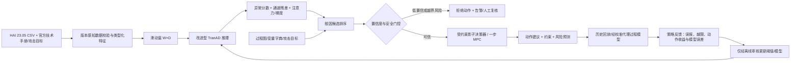

# 基于改进型 TranAD 的工业控制异常感知与安全决策闭环

> **建议题目**：面向硬件在环工业控制系统的异常感知、根因排序与安全动作建议：基于改进型 TranAD 与受约束影子决策的 HAI 研究
>
> **研究定位**：这是一份可执行的硕士研究计划，不是已有实验结果，也不预先宣称新颖性或性能优势已被验证。TranAD 是感知核心；本研究的增量应落在“检测证据如何经验证据约束的根因排序，转成可审计、可拒绝的下游安全决策”以及该链条的实证评估上。首选数据为 HAI 23.05。所有控制动作先以离线/影子建议评估，不直接驱动物理设备。

## 0. 三个系统选题对比与推荐

| 方向 | 系统题目与公开数据 | 可形成的闭环 | 主要研究价值 | 关键数据缺口 / 风险 | 硕士可行性 |
|---|---|---|---|---|---|
| 智算集群可靠性 | GPU/集群慢节点、资源瓶颈感知与负载重调度；Google Borg / Google Cluster Trace，辅以 SMD 或公开 AI 集群 trace | 资源时序检测 → 任务/机器图上的归因 → 作业迁移/限流策略仿真 | AI 集群扩张带来可靠性与能耗压力，系统部署价值高 | Borg v3 官方格式记录作业/实例的 CPU、内存等资源使用，但没有 GPU PCIe、ECC/SDC、硬件健康与慢节点根因标签；用其不能验证 SDC 前兆或 GPU 硬件根因。调度器数字孪生也需要独立校验。[Google Trace v3 schema](https://github.com/google/cluster-data/blob/master/clusterdata_trace_format_v3.proto) | 中低：问题很热，但“可观测字段—故障真值—动作效果”链条断裂，容易做成合成注入和模拟调度 |
| 新能源与储能 | 电池模组异常/热风险预警与微电网储能功率建议；NASA/公开电池循环数据，配微电网/EPIC 类数据 | 电池遥测检测 → 电芯/模组根因 → 限功率、均衡或削峰建议 | 安全与新能源并网价值强，能引入热/电化学先验与约束控制 | NASA PCoE 公开老化数据提供电压、电流、温度、容量/阻抗等周期数据，但主要面向电池老化与寿命；它本身不包含同步的电网动作效果标签。[NASA Li-ion Battery Aging Datasets](https://catalog.data.gov/dataset/li-ion-battery-aging-datasets) 微电网数据的时间跨度、异常覆盖和控制器可复现性也不一。把容量衰退直接说成热失控或实时功率控制证据会过度外推 | 中：若已有电池实验台或真实 BMS 数据则值得做；在仅依赖公开数据的约束下难完成可信的端到端动作效用验证 |
| 工业控制 / CPS | **推荐**：HAI 23.05 四过程 HIL 工业控制异常归因与安全动作建议；HAI 官方 GitHub + 技术手册 | 多变量 SCADA 检测 → 以控制流程/攻击目标约束根因排序 → 受安全包络约束的影子策略建议，并可拒绝动作 | 同一数据资产覆盖锅炉、汽轮机、水处理、HIL 电力仿真；传感、设定值、阀泵命令/状态、攻击标签及版本化目标信息支持较完整链条 | HAI 是历史记录，不自带可重放的完整 HIL 仿真环境或动作后果标签。动作效果须在明确标注的代理预测环境中评估，不能冒充真实工厂干预效果。数据虽在官方仓库公开，22.04/23.05 文件用 Git LFS；须按发布版本核对许可证 | **高**：可获得数据、过程定义和标注；可将工程贡献限制为影子策略和离线安全评估，不需要接入真实 PLC |

### 推荐结论

选择 HAI 23.05 的工业控制/CPS 方向。它在三个候选中最接近用户要求的完整研究链条：官方资料描述了四个耦合过程、86 个 SCADA tag、1 Hz 记录、正常训练文件和带攻击场景的测试文件，并提供控制目标/过程说明；官方仓库还说明 HAIEnd 记录锅炉控制逻辑细节，且发布 NetworkX 图数据。与 SWaT 相比，HAI 官方仓库可直接克隆并通过 Git LFS 拉取，不依赖私有数据或 NDA；与单纯的机器资源 trace 相比，它有物理单位、设定值/命令/测量值以及可评估的攻击目标。[HAI 官方数据仓库及版本说明](https://github.com/icsdataset/hai)，[HAI 技术手册](https://github.com/icsdataset/hai/blob/master/hai_dataset_technical_details.pdf)

这个推荐的范围是“以历史 HIL 数据验证感知和归因，以受约束代理环境验证影子决策流程”，不是声称在真实电站已经完成自动控制闭环。若导师要求以真实干预效用作为核心结论，需借用可访问的 HIL 设备/模拟器；仅有 HAI CSV 不足以支持这个强结论。

## 1. 选题背景与 Research Problem

### 1.1 痛点

工业控制系统中的异常经常沿控制回路传播：某个测点或设定值改变后，控制器、执行器和其他物理量相继响应。仅输出一个时间点的异常分数，无法回答“先检查哪个部件、为什么、哪些动作仍在安全范围内”。另一方面，复杂的重建模型即使检出异常，也可能把相关传感器的高误差当成根因；注意力权重本身不能证明因果关系。最后，检测 F1 提升也不能说明采取动作后过程风险下降。

HAI 数据集来自真实控制设备与硬件在环（HIL）仿真耦合的 CPS 测试床，包含锅炉（P1）、汽轮机（P2）、水处理（P3）和电力 HIL（P4）过程。技术手册定义了物理点的量纲、值域和作用，例如 P1 的压力/水位/温度/流量及阀泵命令与反馈，P2 的转速和四个轴振动探头，P3 的水位、流量、压力与泵阀命令，以及 P4 的频率偏差、负荷、计划功率与输出功率。这些字段使“传感测量—控制指令—过程响应”关系可以被明确建模，而不是从注意力图臆造物理联系。[HAI 技术手册](https://github.com/icsdataset/hai/blob/master/hai_dataset_technical_details.pdf)

### 1.2 Research Problem

给定只含正常数据训练的改进型 TranAD，如何把每个时间窗的异常分数、逐通道重建残差和模型归因，与版本化的过程约束结合，产生一个校准过的根因排序，并在模型不确定或风险过高时输出“拒绝动作”的下游安全建议？

形式化输入为多变量序列 \(X_{t-W+1:t}\in\mathbb{R}^{W\times D}\)，逐通道重建 \(\hat X\)、残差 \(E=|X-\hat X|\)、注意力/梯度归因 \(A\)；另有数据字典和有来源记录的过程图 \(G\)。输出由三个对象组成：异常事件 \(z_t\)、根因候选及证据 \(R_t\)、安全动作建议或 abstain \(u_t\)。

### 1.3 核心假设与可证伪预测

**H1（感知）**：在不使用测试标签调阈值、且不做 Point Adjustment 的条件下，改进型 TranAD 相对朴素阈值与普通 TranAD 在 HAI 23.05 的事件检出质量/延迟有可重复收益。若 eTaPR、VUS-PR、事件召回和检测延迟均无稳定改善，则保留模型作为固定感知器，不把模型改进当作论文贡献。

**H2（归因）**：融合通道残差、模型输入归因、过程先后关系和官方攻击目标的根因排序，比仅按最大残差排序提高 Top-k 命中率/MRR；边打乱、图随机化、注意力打乱应显著降低归因质量。若打乱图后性能不变，因果/拓扑约束没有提供证据，不应宣称其有效。

**H3（决策）**：受正常运行包络与预测不确定性约束的影子决策器，可相对“只报警”和固定动作基线，在代理模型已验证的场景中降低预测越限风险，同时以明确代价控制误动作。若代理模型对动作条件响应预测不准、策略收益只出现在同一攻击事件内、或相对固定策略无收益，则动作效用结论被证伪；只报告建议质量和拒绝率。

### 1.4 近年文献中的 Gap 与定位

NeurIPS 2024 的 TSB-AD 工作指出，TSAD 数据集、评价度量和基线实现存在系统性问题；其大规模比较中，简单统计方法在不少设置下可与复杂神经网络竞争。因此本研究必须报告强朴素基线、运行代价和事件级指标，不能用一个 PA-F1 数字支撑贡献。[TSB-AD, NeurIPS 2024 Datasets & Benchmarks](https://proceedings.neurips.cc/paper_files/paper/2024/hash/c3f3c690b7a99fba16d0efd35cb83b2c-Abstract-Datasets_and_Benchmarks_Track.html)

OpenReview 上的 TSAD 评估研究明确讨论了 Point Adjustment（PA）对异常片段内单点命中的扩张偏置，并提出替代评测方案；该证据支持采用原始点级和事件级指标、固定正常验证阈值，不将 PA-F1 作为主结果。[Towards Unbiased Evaluation of Time-series Anomaly Detector, OpenReview](https://openreview.net/forum?id=CseY9pxbsN)

因果根因分析也不是空白。ICLR 2025 的 AERCA 已把 Granger 因果发现与根因分析结合；AAAI 2025 的 GCAD 使用梯度发现 Granger 因果并以因果模式变化检测异常；ICLR 2025 的 CaPulse 使用结构因果模型和周期性归一化流。因此“把 TranAD 注意力画成热图”或“首次用因果图解释异常”都不足以作为新颖性声明。可检验的差异应是：对既有 TranAD 感知资产进行冻结或最小适配，采用数据手册可追溯的过程图和攻击目标，校准异常证据到根因候选，再以不确定性门控把结果送入显式安全约束的下游策略，并端到端评估建议质量。[AERCA, ICLR 2025/OpenReview](https://openreview.net/pdf?id=k38Th3x4d9)，[GCAD, AAAI 2025](https://ojs.aaai.org/index.php/AAAI/article/view/34096)，[CaPulse, ICLR 2025/OpenReview](https://openreview.net/pdf?id=zVp0TVDkrX)

2026 年公开的 CPS 对抗实验工作采用并行在线/离线控制器、动作监视与控制器状态切换来验证韧性，说明下游控制效果需要独立的过程实验，而不是由检测分数推断。[RESPONSE 实验验证, AIChE Journal 2026](https://aiche.onlinelibrary.wiley.com/doi/10.1002/aic.70269)

**OpenReview 审稿证据说明**：本轮检索到 OpenReview 托管的论文与评测讨论，但匿名评审逐条评论接口未在当前连接器中成功返回，故本方案不把上述论文结论伪装成“审稿人原话”。可据此设计审稿防线：禁止 PA 主结果；以独立事件切分和未见攻击评估；不把注意力等同因果；逐项列明动作假设、过程边界与代理模型可信度；若没有真实动作回放，明确将效用称为仿真/代理效用。

## 2. 顶会级架构设计

### 2.1 端到端流程



### 2.2 三层模块和接口

| 层 | 模块 | 输入 | 输出协议（建议 JSON） | 约束 |
|---|---|---|---|---|
| 感知 | `data/prepare_hai.py`、`models/tranad_adapter.py`、`detect/stream.py` | 时间戳、已登记的 D 个过程点；标签列只供离线评估 | `DetectionRecord{timestamp, window_id, score, threshold, channel_residual[D], attention_summary, model_version, quality_flags}` | 只能用训练正常段拟合缩放和阈值；禁止把 `attack*`、攻击目标、测试文件名送入模型 |
| 归因 | `explain/rootcause.py` | `DetectionRecord`、`tag_schema.yaml`、`process_graph.json` | `RootCauseRecord{event_id, candidates:[{tag, score, evidence, predecessor_path}], graph_version, confidence, abstain_reason}` | 注意力只是候选证据；无有向过程支持的边不得写作因果边；攻击目标只在测试打分时用于核验 |
| 决策 | `decision/shadow_policy.py`、`sim/closed_loop.py` | 异常等级、根因候选、当前安全状态和不确定性 | `ActionAdvice{action_set, selected_action|null, expected_risk, constraint_checks, rationale, valid_until, mode:advisory|abstain}` | 不向 PLC 写入；所有变量值域和动作规则来自可追溯手册/配置；代理模型不确定时必须 abstain |

统一协议采用 Parquet/Arrow 保存逐秒输入与分数；每条事件另存 JSONL。所有记录都含 `dataset_version`、源文件哈希、`model_version`、`schema_version`、窗口起止时间和阈值来源，以便复现实验。事件级输出用 UTC/原始时间戳并同时保存原时区/格式，不对时间戳做插值或排序外推。

## 3. 改进型 TranAD 的角色与适配细节

### 3.1 输入特征

主实验以 HAI 23.05 的 HAI CSV 为准，目标版本为官方文档所列 86 个 SCADA points、1 点/秒；程序仍须从实际文件表头自动确认列数，因为官方手册的点表序号与总数可能因版本差异/文档修订存在不一致。预处理脚本遇到版本/列名/数量不匹配时应失败并打印差异，禁止静默裁切。

字段按类型建模，具体名称和单位从发布包技术手册生成 `tag_schema.yaml`：

- **P1 锅炉**：压力/水位/温度/流量测量及 setpoint；阀门 `*D` 命令和 `*Z` 反馈；泵启停命令/运行状态等布尔点（如 `P1_PP01AD/AR`、`P1_PP02D/R`）。
- **P2 汽轮机**：转速 `P2_SIT01`、轴振动 `P2_VIBTR01`–`P2_VIBTR04`、相位/控制状态及手自动/启停信号；振动传感器采用技术手册单位 μm，转速采用 RPM。
- **P3 水处理**：`P3_FIT01` 流量、`P3_LIT01` 水位、`P3_PIT01` 压力、`P3_LCP01D` 泵速命令、`P3_LCV01D` 阀位命令及水位设定点。
- **P4 HIL 电力**：`P4_HT_FD`、`P4_ST_FD` 频率偏差，HT/ST 负荷、计划功率和输出功率，以及汽轮机阀门开度/压力/温度数字点。
- **明确排除**：`time` 不作为模型特征；`attack`、旧版本的 `attack_P1/P2/P3`、任何攻击目标文件、攻击场景编号均仅用于切分后的评估与根因标注。命令/状态布尔量不做连续变量的 z-score；采用类型专用编码/缩放，并保留类别掩码。

原始手册列出物理点名称、单位、值域和含义；例如阀门开度命令/反馈、泵启停状态、振动探头、汽轮机转速、频率偏差和计划/输出功率。每个特征的单位和值域须从所用 HAI 版本的手册生成，非手册支持的特征留作 `unknown`，不从名称猜测物理意义。[HAI 技术手册数据点章节](https://github.com/icsdataset/hai/blob/master/hai_dataset_technical_details.pdf)

### 3.2 窗口与训练

- 采样频率：官方 HAI 23.05 为 1 Hz；先检查 timestamp 连续性和重复行。不得对跨文件边界或数据缺口造窗。
- 初始窗长：`W=128` 秒，步长 `S=1` 秒用于离线精细评估；流式原型可按 5 秒批处理以降低重复推理量。`W` 和 `S` 是首轮配置超参数，须用正常验证集和延迟预算选择，不允许看测试攻击标签调参。
- 输入张量：`float32 [batch, W, D]`，另以 mask 标记离散/连续通道。TranAD 原始推理输出时间窗重建；改进型版本保持已有损失、注意力结构和训练细节，用一个 adapter 隔离其实现差异。
- 仅正常训练文件用于拟合模型和 scalers；按文件/时间段划分 train/validation/test，窗口不得穿越 split 边界。归一化统计只从 train normal 拟合。阈值从 validation normal 的预先声明分位数或误报率目标校准，锁定后一次性用于 test。
- 默认只做离线窗口化和连续推理回放。若现有改进模型在异常片段训练过，主实验须额外训练“仅正常数据”版本；否则清楚报告监督信息，不能将其描述为无监督检测。

### 3.3 检测证据的传递

对第 \(j\) 个通道使用训练正常残差尺度 \(s_j\) 归一化：

\[
e_{t,j}=\frac{|x_{t,j}-\hat x_{t,j}|}{s_j+\epsilon},\qquad
score_t=\operatorname{Agg}_j(e_{t,j})
\]

`Agg` 作为可配置的 max、截尾均值或校准后的分位数聚合；主结果预先固定一个，其他作为敏感性分析。输出 `score_t`、每通道 `e_{t,j}`，以及窗口聚合注意力矩阵摘要。注意力可用来产生待检验的变量交互候选，但不能直接解释成“模型因果”。额外保存对 `score_t` 的梯度或 Integrated Gradients：在正常验证集构造基线输入，报告各变量贡献的有符号/绝对值。

检测 API 示例：

```json
{"schema_version":"1.0","dataset_version":"HAI-23.05","timestamp":"2023-05-01T12:34:56Z","window":{"start":"2023-05-01T12:32:49Z","length_s":128},"score":0.91,"threshold":0.83,"channel_residual":{"P2_SIT01":2.8,"P2_VIBTR01":4.1},"attention_top_pairs":[["P2_SIT01","P2_VIBTR01",0.42]],"attribution":{"P2_VIBTR01":0.37},"model_version":"tranad-improved-<hash>","quality_flags":[]}
```

数值仅作字段格式示例，不代表结果。

## 4. 根因可解释性与下游动作模块

### 4.1 根因排序，不把注意力当因果

建立来源明确的过程有向图：节点对应数据字典中的物理点/控制点，边对应技术手册中的过程流、控制回路、命令到反馈关系；HAI 23.05 官方图数据可作为锅炉内部控制逻辑的补充，但不把其范围外的跨过程边外推。每条边保存 `source`、`version`、`confidence` 和是否为文档直接支持。

候选根因对每个节点组合以下证据：

1. **异常幅度**：该通道标准化残差在事件开始附近的变化。
2. **模型归因**：对异常分数的 Integrated Gradients/遮挡敏感度。对遮挡采用同阶段正常条件中位数或局部正常窗口替换，避免全零输入离开数据分布。
3. **时序先后**：找出最早出现异常的候选节点；区分先导异常与随后传播的响应异常。
4. **过程支持**：用有向图把有直接证据的上游候选与下游残差路径区分开；无依据节点不因为注意力权重大就获得“原因”标签。
5. **模型稳定度**：跨相邻窗口/随机种子/轻微噪声扰动后排名稳定程度。

生成 `root_score(j)=calibrate(residual, attribution, onset, graph_support, stability)`。校准器只能在 train/validation normal 上拟合；以攻击目标文件和官方场景描述作测试期 ground truth 核验，不参与排名函数调参。与最大残差、Integrated Gradients only、注意力 only、无图候选排序对照。评测攻击目标 Top-1/Top-3、MRR、首个根因延迟，并分别报告“图可覆盖的攻击”和“无图覆盖的攻击”。

注意力、梯度、残差均为模型证据或敏感性证据；真正的因果结论需要干预/实验支持。没有受控干预时，系统字段使用 `root_cause_candidate` 而不是 `causal_root_cause`。因果图边随机化、滞后顺序打乱、攻击目标置换是强负控。

### 4.2 受约束影子决策器

决策器将异常等级与根因候选映射为**动作建议**，例如要求操作员检查某泵/阀、维持当前设定值、切入预先规定的保守运行模式，或对 P4 功率/负荷提出在已知运行范围内的调整建议。物理动作清单不能只由 LLM 或注意力生成；必须由导师/过程工程依据手册审核后录入 `action_catalog.yaml`，标出可影响的过程点、适用条件、不可逾越的上下界和回退步骤。没有设备明确支持的“关阀/停泵”等动作不得自动加入。

影子策略使用轻量的一步/短视域约束决策：

\[
\min_{u_{t:t+H}} \sum_{k=1}^H \big(\lambda_r\widehat{Risk}_{t+k} + \lambda_u\|u_{t+k}-u_{t+k-1}\|^2 + \lambda_c Cost(u_{t+k})\big)
\]

约束包括动作目录允许集合、技术手册值域、执行器变化速率（若有依据）、正常验证集包络和过程变量安全边界。若风险代理预测不确定性过高、候选动作超范围或根因置信不足，输出 `selected_action=null, mode="abstain"`，由人工确认。所谓“代理模型”需用时间切分的训练数据拟合一步状态转移，在保留的正常段报告预测误差/区间覆盖；只有通过此门槛才比较策略建议。异常/攻击后果不得靠正常数据模型假装已验证。

闭环验证分两级：

- **数据回放闭环**：对每个事件回放检测、归因、建议时序，检查动作建议是否在边界内、是否比静态阈值建议更早/更有针对性；衡量 abstain、误建议和延迟。
- **代理过程闭环**：在明确声明为近似的动作条件转移模型中比较 no-action、固定保守策略和自适应策略，报告模型预测不确定性、越限率代理、恢复时间代理和干预成本。与未知真值相关的指标必须标成“仿真代理指标”。没有真实 HIL 回放时，不把它们写成物理系统实测效用。

### 4.3 决策输出格式

```json
{"schema_version":"1.0","event_id":"evt-000123","root_cause_candidates":[{"tag":"P2_VIBTR01","rank":1,"confidence":0.78,"evidence":["residual","integrated_gradients","process_graph"]}],"action_set":["operator_inspect_turbine_vibration","hold_current_speed_demand"],"selected_action":"operator_inspect_turbine_vibration","mode":"advisory","expected_risk_proxy":0.12,"constraint_checks":{"within_catalog":true,"within_tag_range":true,"surrogate_uncertainty":"medium"},"valid_until":"2023-05-01T12:35:10Z","rationale":"候选解释需人工确认；未写入 PLC。"}
```

示例仅展示接口字段。根因置信度、策略阈值、动作及其安全范围都须由实验和领域审核确认。

## 5. 验证实验与 Baseline

### 5.1 数据和切分

**主数据集**：HAI 23.05（官方仓库 `hai-23.05`）。仓库文档指出每个 CSV 时间连续；第一列为时间，其余列为 SCADA 点，标签列标记攻击。23.05 的数据以 Git LFS 管理，克隆后执行 `git lfs pull`。从官方 CSV 读取时应在预处理脚本中断言列名、时间连续性、标签列以及与对应版本技术手册的交集；将所有原始文件哈希和 tag 映射表存档。[HAI 官方 README](https://github.com/icsdataset/hai/blob/master/README.md)

建议协议：`hai-train1` 至 `hai-train4` 中官方标记为正常的文件作为训练/验证源；`hai-test1` 与 `hai-test2` 按完整文件保留做最终测试，测试标签不参与早停、阈值选择、图边选择、解释器参数搜索或策略调参。场景级结果按攻击事件分别报告；如存在跨 test 文件重复场景，以场景/攻击目标分组防止泄漏。攻击目标文件只用于测试期 root-cause scoring。若具体 release 文件布局与 README 命名有变化，以下载的版本清单和 CSV header 为准并记录差异。

### 5.2 Baseline

1. 单通道阈值：训练正常分位数与 robust z-score。
2. PCA / Isolation Forest 或 One-Class SVM：多变量传统基线。
3. 原始 TranAD 与改进型 TranAD：隔离模型变更带来的贡献。
4. USAD、Anomaly Transformer、GDN：代表性重建/注意力/图基线；统一数据、训练预算和阈值协议。
5. 根因对照：最大残差排序、IG 排序、注意力排序、图约束排序、图随机化负控。
6. 决策对照：只告警、固定安全建议、自适应影子策略、随机合法动作负控。

### 5.3 评价指标

- **检测质量**：点级 PR-AUC、VUS-PR、eTaPR、事件级 precision/recall/F1、每小时误报数、每事件首次检测延迟。PA-F1 可在附录为历史可比性报告，但不得当主指标；不得用测试集最优阈值。
- **根因定位**：攻击目标 Top-1/Top-3、MRR、首个目标定位延迟；按有官方目标、无目标、单点/多点场景分层。攻击目标和物理根因并不总是等价，需分别命名指标。
- **决策建议**：合法动作比例、约束违反率（代理仿真与输入边界分别计）、abstain 覆盖率、建议延迟、误建议率、代理模型下的预测越限风险与动作成本；清楚标注 surrogate-only 结果。
- **效率**：每窗 CPU/GPU 延迟、每秒吞吐、模型参数/显存、解释开销和端到端建议时延。
- **统计**：至少多个随机种子；按攻击事件 bootstrap 置信区间。报告均值、中位数及跨场景分布，不只报最佳 seed。

### 5.4 消融与证伪实验

| 消融/负控 | 移除或替换 | 回答的问题 / 失败解释 |
|---|---|---|
| A1 | 原始 TranAD 替代改进型 | 已有模型优势是否能迁移到系统任务 |
| A2 | 只用最大残差，不做归因 | 归因是否提高根因 Top-k/MRR |
| A3 | 移除 attention/IG，各自单独启用 | 注意力/梯度证据的独立价值；不预设注意力是因果 |
| A4 | 移除过程图、随机重连图 | 官方过程结构是否真实增加定位能力 |
| A5 | 置换攻击目标、打乱事件起点 | 排除标签泄漏和时间对齐捷径 |
| A6 | PA-F1 与无 PA 指标并列 | 主结论是否依赖 PA 的点扩张偏置 |
| A7 | 只告警 / 固定建议 / 自适应策略 | 建议闭环是否优于固定规则，而非只有分类指标 |
| A8 | 使用代理模型置信区间门控 vs 不门控 | 安全门控是否减少代理越限，代价是否可接受 |
| A9 | 已知攻击类型内插 vs 留一攻击场景外推 | 是否记忆攻击脚本而非获得可迁移能力 |

**停止/降级标准**：若测试结果对阈值、PA 或单一攻击场景敏感，检测结论降级；若根因仅在攻击标签参与开发后变好，撤销归因结论；若代理预测在留出时间段不校准，撤销策略效果主张，保留安全建议接口和误差分析。

## 6. Week 1–12 实施路线图

| 周 | 里程碑与 Python 文件 | 接口/产物 |
|---|---|---|
| 1 | `scripts/fetch_hai.py`、`scripts/manifest.py`：克隆官方仓库、LFS 拉取、记录版本、许可证文本、SHA256、文件清单 | `data/raw_manifest.json`；记录文件名、大小、哈希、来源 URL。只下载公开版本，不提交原始数据进 Git |
| 2 | `src/data/inspect_schema.py`、`src/data/validate_time.py`：解析 CSV header、时间连续性、缺失/重复、版本字段差异；人工核对技术手册字段 | `config/tag_schema.yaml`；每个 tag 有名称、单位、类型、上下界、过程、定义来源、可信等级。生成 `reports/schema_audit.md` |
| 3 | `src/data/prepare_hai.py`、`src/data/split_events.py`：按文件/场景切分，排除标签特征，生成 Parquet 和事件清单 | `data/processed/{split}.parquet`；列为 `timestamp, tag_*, label_attack, event_id, source_file`，标签与模型输入分离 |
| 4 | `src/data/window.py`、`src/data/fit_scaler.py`、`src/data/build_graph.py`：窗化、仅正常训练缩放器、建立有来源过程图 | 窗口 `x:[N,W,D]`, `mask:[N,W,D]`；`process_graph.json` 含边来源和版本；异常/跨文件窗口单测由 Week 4 运行 |
| 5 | `src/models/tranad_adapter.py`、`src/models/load_checkpoint.py`：封装现有改进型 TranAD，确认窗口输入输出与 checkpoint 版本 | 推理接口 `predict(batch)->{reconstruction, attention?}`；记录参数哈希，避免改动基础模型时接口漂移 |
| 6 | `src/detect/score.py`、`src/detect/calibrate.py`、`src/detect/replay.py`：残差标准化、固定验证阈值、滑窗回放与延迟测量 | `scores.parquet`：时间、score、threshold、逐通道误差、质量标志；阈值文件 `thresholds.json` 指明正常验证数据来源 |
| 7 | `src/explain/attribution.py`、`src/explain/rootcause.py`：梯度/遮挡归因，融合过程图与最早异常顺序 | `rootcause.jsonl`：候选、分数分解、图路径、置信度、是否 abstain；所有候选有证据来源 |
| 8 | `src/decision/action_catalog.py`、`src/decision/shadow_policy.py`：实现合法动作枚举、正常包络约束、风险目标与拒绝条件 | `advice.jsonl`：建议动作/null、风险代理、约束检查和 rationale；静态合法动作检查 |
| 9 | `src/sim/fit_surrogate.py`、`src/sim/validate_surrogate.py`、`src/sim/closed_loop.py`：拟合只作影子评估的状态转移代理，先评估预测误差再比较策略 | `surrogate_card.json`：训练范围、预测误差/区间覆盖、禁用场景；`policy_replay.parquet` 标注 surrogate-only |
| 10 | `src/bench/run_detection.py`、`src/bench/run_rca.py`、`src/bench/run_policy.py`：统一运行 baselines、按事件评估 | `metrics_detection.csv`、`metrics_rca.csv`、`metrics_policy.csv`；配置和 git commit 哈希写入每行元数据 |
| 11 | `src/bench/ablation.py`、`src/bench/bootstrap.py`、`scripts/make_figures.py`：完成负控、消融、置信区间、事件案例可视化 | `reports/results.md`、`figures/`；明确结果支持/不支持哪些假设，保留失败案例 |
| 12 | `scripts/reproduce_all.py`、`scripts/package_artifacts.py`：整理论文表格、复现实验命令、接口文档和局限 | 清洁环境可由单一 config 复跑；最终交付图表、配置、数据获取说明、数据字典、OpenReview/文献记录与风险声明 |

建议目录：

```text
project/
  config/{experiment.yaml,tag_schema.yaml,action_catalog.yaml}
  data/{raw_manifest.json,processed/}      # raw data 不入库
  src/{data,models,detect,explain,decision,sim,bench}/
  scripts/{fetch_hai.py,reproduce_all.py,make_figures.py}
  reports/{schema_audit.md,results.md,limitations.md}
  artifacts/{scores.parquet,rootcause.jsonl,advice.jsonl,metrics_*.csv}
```

## 文献检索、连接器与待核查事项

- IdeaSpark 的 arXiv 检索返回了近期记录。OpenAlex 检索请求返回 HTTP 400；Semantic Scholar 对匿名请求返回 HTTP 429 并重试。OpenReview 官方 API 返回 challenge-required HTTP 403（2026-11-06），本轮未取得其 connector 记录。具体状态与原始返回保存在 `ideaspark_run/tranad-closed-loop-system/`；OpenAlex/OpenReview 的 connector 输出不作为本方案文献证据。
- 当前运行环境无独立 Exa 或 Scraper 工具。已用公开网络检索和官方 HAI 仓库/技术手册核对版本与字段定义；最终脚本仍必须对照实际下载的 CSV header 和手册做 schema audit。没有声称执行了独立 Scraper 服务。
- OpenReview 页面和论文可访问；当前抓取未成功得到匿名 reviewer 原始评论，因此本文引用 OpenReview 托管论文/评估研究所明确讨论的限制，不捏造审稿意见。若正式投稿前需要“审稿阶段硬伤”的直接证据，应通过 OpenReview v2 API 导出相关公开 `Official_Review` / `Meta_Review`，保存 forum ID、评论字段、review date 和论文最终版本，并将逐条证据加入 `reports/openreview_review_audit.md`。
- HAI README 标注了 CC BY 4.0，技术手册 v4.0 标注 CC BY-SA 4.0；按实际数据版本核对许可文件并按较严格规则处理，避免把数据文件复制到代码仓库或论文补充材料。
- 既有的“改进型 TranAD”性能结果需在本文协议下复现。任何不确定项（模型 checkpoint、改进细节、算力配置、标签版本）作为 intake 假设记录，不影响先完成可执行的数据/接口骨架，但会影响最终实验结论。
